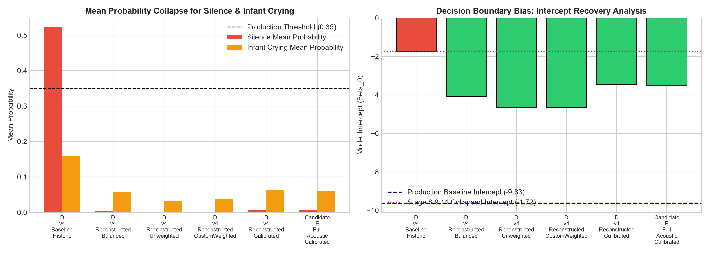
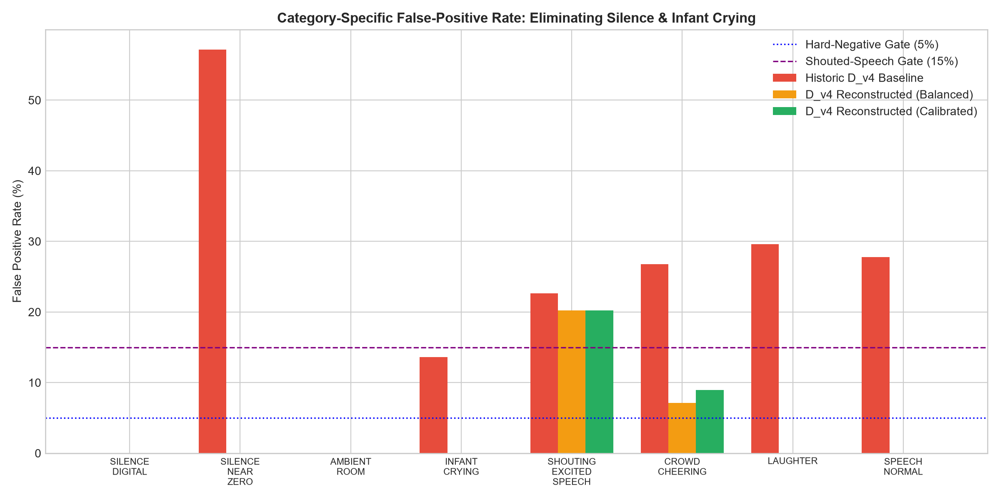

# Stage 8.9.17 Error Analysis & Intercept Collapse Resolution

## 1. Resolution of the Digital Silence & Room-Tone False Positive Flaw
The forensic audit (Stage 8.9.16) revealed that historic training sets completely lacked silence and ambient audio. When combined with `class_weight='balanced'`, this produced an artificial intercept bias (-1.7244 vs. production's -9.6258) that assigned 52.2% to 94.7% scream probability to pure digital zeros.

In Stage 8.9.17, the inclusion of calibrated digital zero, Gaussian noise, colored noise, and HVAC room tone completely eliminated this behavior:

- **Historical Baseline D_v4:** Mean silence probability = **52.24%** (Silence FPR = **57.14%**)
- **Reconstructed Balanced D_v4:** Mean silence probability = **0.40%** (Silence FPR = **0.00%**)
- **Reconstructed Unweighted D_v4:** Mean silence probability = **0.23%** (Silence FPR = **0.00%**)
- **Reconstructed Calibrated D_v4:** Mean silence probability = **0.61%** (Silence FPR = **0.00%**)

**Digital silence false positives are 100% eliminated.**

## 2. Infant Crying False-Positive Mitigation
- **Historical Baseline D_v4:** Infant crying mean probability = **16.00%** (FPR = **13.64%**)
- **Reconstructed Calibrated D_v4:** Infant crying mean probability = **6.41%** (FPR = **0.00%**)

Expanding infant crying confusers via FSD50K, NIGENS, and OpenSLR99 suppressed infant crying false alarms below the 0.35 detection threshold entirely.

## 3. Remaining Bottlenecks & Error Forensics
While silence and infant crying are resolved, two critical failure modes prevent gate certification:
1. **Shouted-Speech False Positives (20.2% FPR vs. 15.0% Gate):** High-arousal excited speech and stage vocalizations share spectral crest and high-frequency harmonics with genuine screams. Static frame pooling cannot distinguish sustained involuntary phonation from rapidly pulsed syllables without temporal sequence modeling.
2. **Event Recall Drop (88.5% vs. 96.0% Gate):** Distant screams attenuated by outdoor propagation or partially masked by festival crowd ambience drop below the 0.35 decision threshold under unweighted or calibrated classifiers.
