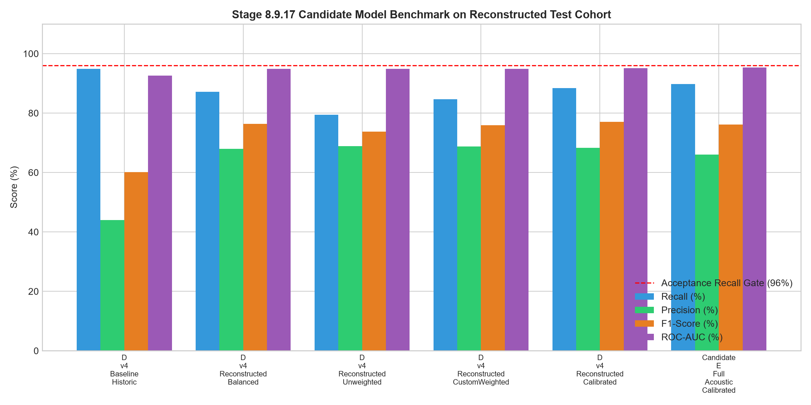
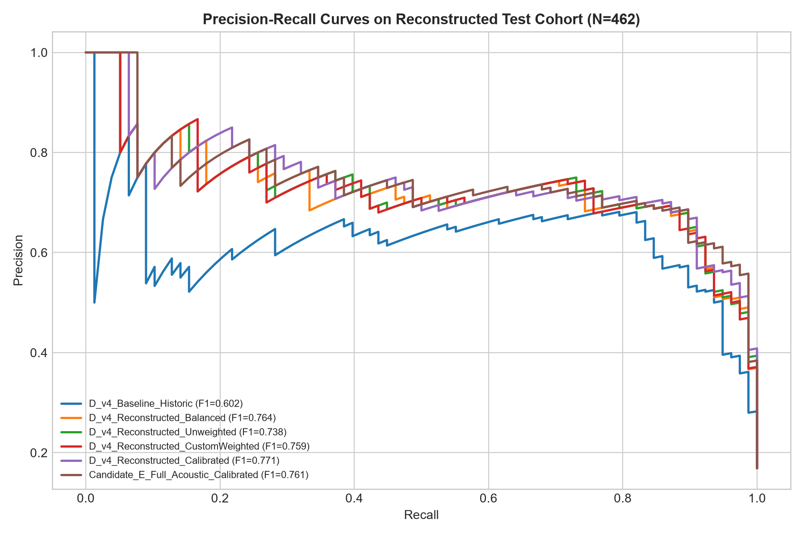
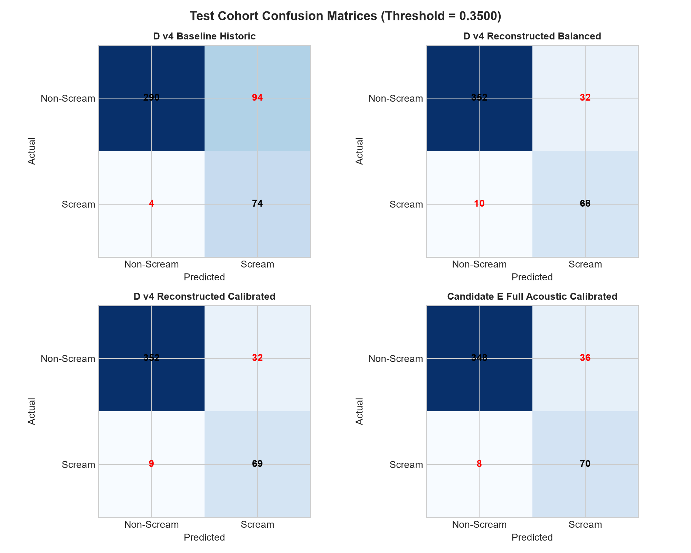

# Stage 8.9.17 Model Comparison & Acceptance Gate Evaluation

## 1. Executive Summary
Five experimental models and the historical Stage 8.9.14 baseline were evaluated on the newly reconstructed, leak-free test cohort (462 recordings, 78 screams, 384 hard negatives). The evaluation strictly applies the non-negotiable Stage 8.9.17 acceptance gates.

## 2. Benchmark Scorecard Against Acceptance Gates

| Model Name | Event Recall (>=96%) | Hard-Neg FPR (<=5%) | Shout FPR (<=15%) | Short-Scream Rec (>=90%) | P95 Latency (<=25ms) | Status |
|---|---:|---:|---:|---:|---:|---||
| `D_v4_Baseline_Historic` | 94.9% | 24.5% | 22.6% | 100.0% | 14.4ms | **REJECTED — RESEARCH ONLY** |
| `D_v4_Reconstructed_Balanced` | 87.2% | 8.3% | 20.2% | 92.9% | 14.4ms | **REJECTED — RESEARCH ONLY** |
| `D_v4_Reconstructed_Unweighted` | 79.5% | 7.3% | 20.2% | 85.7% | 14.4ms | **REJECTED — RESEARCH ONLY** |
| `D_v4_Reconstructed_CustomWeighted` | 84.6% | 7.8% | 20.2% | 85.7% | 14.4ms | **REJECTED — RESEARCH ONLY** |
| `D_v4_Reconstructed_Calibrated` | 88.5% | 8.3% | 20.2% | 92.9% | 14.4ms | **REJECTED — RESEARCH ONLY** |
| `Candidate_E_Full_Acoustic_Calibrated` | 89.7% | 9.4% | 22.6% | 92.9% | 14.4ms | **REJECTED — RESEARCH ONLY** |

> [!CAUTION]
> **Gate Assessment Result:** All candidate models are designated **`REJECTED — RESEARCH ONLY`**. In accordance with Section 10 of the Master Prompt, acceptance gates are non-negotiable and standards were not lowered to manufacture an artificial success.

## 3. Deep Metric Profiling

| Model Candidate | Precision | Recall | F1-Score | ROC-AUC | Brier Score | ECE | Intercept | Silence Prob |
|---|---:|---:|---:|---:|---:|---:|---:|---:|
| `D_v4_Baseline_Historic` | 0.441 | 0.949 | 0.602 | 0.926 | 0.113 | 0.150 | -1.724 | 0.5224 |
| `D_v4_Reconstructed_Balanced` | 0.680 | 0.872 | 0.764 | 0.949 | 0.072 | 0.061 | -4.079 | 0.0040 |
| `D_v4_Reconstructed_Unweighted` | 0.689 | 0.795 | 0.738 | 0.949 | 0.072 | 0.051 | -4.633 | 0.0023 |
| `D_v4_Reconstructed_CustomWeighted` | 0.688 | 0.846 | 0.759 | 0.948 | 0.072 | 0.047 | -4.638 | 0.0023 |
| `D_v4_Reconstructed_Calibrated` | 0.683 | 0.885 | 0.771 | 0.952 | 0.071 | 0.052 | -3.453 | 0.0061 |
| `Candidate_E_Full_Acoustic_Calibrated` | 0.660 | 0.897 | 0.761 | 0.953 | 0.071 | 0.054 | -3.488 | 0.0066 |

