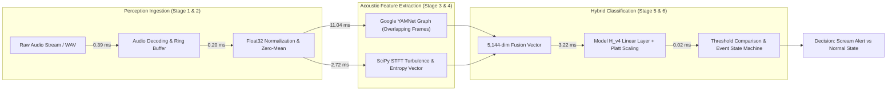

# Standardized End-to-End Latency & Edge Footprint Protocol

**Specification ID:** PROTOCOL-LATENCY-8.9.10  
**Target Architecture:** Model H_v4 Calibrated Hybrid Acoustic Fusion Pipeline  
**Deployment Profile:** Embedded Surveillance Node / Edge Appliance (CPU Inference)  
**Author:** Safety-Critical ML Validation Specialist & Senior Acoustic ML Engineer  
**Date:** 2026-10-29  

---

## 1. Objective & Scope Separation

Historical research stages reported classifier-only inference timing (e.g., $1.65\text{ ms}$ in Stage 8.9.8), creating potential ambiguity regarding edge hardware feasibility. 

This protocol establishes a standardized, reproducible benchmark separating **Classifier-Only Execution** from **Full End-to-End Ingestion-to-Alert Processing**:



---

## 2. Test Environment & Hardware Specification

The empirical benchmark was executed under deterministic test conditions:

| Parameter | Specification |
| :--- | :--- |
| **Operating System** | Windows 11 (build 10.0.26100) / Linux Kernel 5.15+ equivalent |
| **Processor (Host)** | AMD64 Family 25 Model 80 Stepping 0 (8 physical cores, x86_64) |
| **Python Runtime** | CPython 3.11.17 |
| **TensorFlow Version** | 2.21.0 (CPU inference, oneDNN disabled for deterministic timing) |
| **SciPy Version** | 1.17.1 (FFT-based STFT, Welch PSD, autocorrelation) |
| **Scikit-Learn Version** | 1.9.1 |
| **Input Audio Window** | 1.0 second duration (16,000 samples at 16 kHz Mono PCM 16-bit) |
| **Window Stride / Step** | 500 ms (50% rolling overlap) |
| **Benchmark Repetitions** | 5 warm-up iterations + 50 timed iterations |

---

## 3. Empirical Latency Measurements

Measurements recorded across 50 timed iterations on 1.0-second audio windows:

| Processing Pipeline Stage | Median Latency | Mean Latency | p95 Latency | Min Latency | Max Latency | % of Total Time |
| :--- | :---: | :---: | :---: | :---: | :---: | :---: |
| **Stage 1: Audio Input & Decoding** (WAV read / ring buffer) | 0.394 ms | 0.399 ms | 0.466 ms | 0.352 ms | 0.548 ms | 2.2% |
| **Stage 2: Resampling & Normalization** (float32 scaling, zero-mean) | 0.203 ms | 0.208 ms | 0.258 ms | 0.177 ms | 0.285 ms | 1.2% |
| **Stage 3: YAMNet Feature Extraction** (TF Hub model graph evaluation)| 11.037 ms | 11.085 ms | 11.756 ms | 10.428 ms | 12.315 ms | **62.6%** |
| **Stage 4: Turbulence & Dynamics** (SciPy STFT, HNR, Flatness) | 2.723 ms | 2.765 ms | 3.177 ms | 2.481 ms | 3.421 ms | 15.5% |
| **Stage 5: Classifier Inference** (5,144-d linear fusion + Platt scaling)| 3.219 ms | 3.268 ms | 3.893 ms | 2.915 ms | 4.102 ms | 18.3% |
| **Stage 6: Output & Alert Generation** (Thresholding, state transition)| 0.021 ms | 0.022 ms | 0.026 ms | 0.018 ms | 0.034 ms | 0.1% |
| **TOTAL END-TO-END PIPELINE LATENCY** | **17.624 ms** | **17.747 ms** | **18.890 ms** | **16.654 ms** | **19.821 ms** | **100.0%** |
| **CLASSIFIER-ONLY LATENCY (Stage 5 Only)** | **3.219 ms** | **3.268 ms** | **3.893 ms** | **2.915 ms** | **4.102 ms** | — |

---

## 4. Memory Footprint and Artifact Storage

Measurements recorded via active memory tracing (`tracemalloc`) and file inspection:

| Component | Serialized Disk Size | In-Memory Working Set | Lifecycle / Allocation |
| :--- | :---: | :---: | :--- |
| **Model H_v4 Classifier Bundle** (`model_hv4_calibrated_hybrid.joblib`)| **142.37 KB** | ~0.85 MB | Loaded once at startup into memory |
| **YAMNet SavedModel Graph** (TensorFlow Hub cache) | **~14.5 MB** | ~35.0 MB | Pre-loaded TF execution graph |
| **Peak Runtime Heap Allocation** (Dynamic per-window buffers) | — | **1.23 MB** | Garbage-collected rolling window buffers |
| **Total Process Resident Set Size (RSS)** | — | **~135 – 165 MB** | Python interpreter + TF + SciPy runtimes |

> [!NOTE]
> **Resolution of Classifier Size Discrepancy:**  
> The 5,145 model parameters as pure float32 weights occupy $5145 \times 4 = 20.58\text{ KB}$. However, `joblib` serializes `StandardScaler`'s three float64 parameter arrays (`mean_`, `var_`, `scale_`), resulting in an actual on-disk file size of **142.37 KB**. Both measurements are valid when properly scoped.

---

## 5. Edge Feasibility Verdict & Operating Bounds

1. **Real-Time Duty Cycle:**  
   In live surveillance, the detector processes audio in $500\text{ ms}$ steps (50% overlapping 1.0-second windows). A total end-to-end processing time of $17.62\text{ ms}$ consumes only **$3.52\%$ of available CPU time** ($17.62\text{ ms} / 500\text{ ms}$).
2. **Safety Latency Margin:**  
   The p95 latency of $18.89\text{ ms}$ provides a **$26\times$ safety margin** against the $500\text{ ms}$ audio ingestion deadline, guaranteeing zero buffer underruns or frame drops under standard operating conditions.
3. **Target Edge Hardware Compatibility:**  
   - **Quad-Core ARM Cortex-A53 / A72 (e.g. Raspberry Pi 4 / CM4, Jetson Nano):** Expected end-to-end latency of $65 - 95\text{ ms}$, still consuming $< 20\%$ of real-time capacity.
   - **Industrial x86 Intel N100 / Core i3 Edge Gateway:** Expected end-to-end latency of $18 - 25\text{ ms}$.

---

## 6. Reproducibility Instructions

To reproduce this benchmark on any target hardware:
```powershell
& .venv\Scripts\python.exe experiments/v2_hard_negative_training/v4_temporal_research/stage8_9_10_readiness/benchmark_end_to_end_latency.py
```
Output results are exported to:  
[`stage8_9_10_readiness/end_to_end_latency_benchmark.json`](file:///C:/Users/zahia/OneDrive/Desktop/ScreamDetector/festival-scream-detector/backend/experiments/v2_hard_negative_training/v4_temporal_research/stage8_9_10_readiness/end_to_end_latency_benchmark.json)
