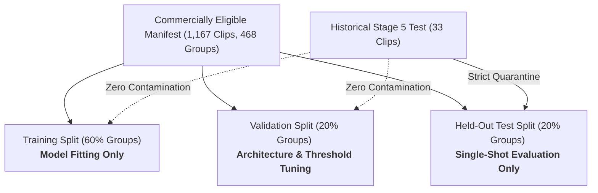

# Stage 8.9.11 Preregistered Evaluation Protocol & Model Selection Plan

**Specification ID:** PREREG-PROTOCOL-8.9.11  
**Target Stage:** Stage 8.9.11 (Prospective Experimental Training & Evaluation)  
**Status:** Preregistered & Frozen Prior to Any Model Training  
**Author:** Safety-Critical ML Validation Specialist & Senior Acoustic ML Engineer  
**Date:** 2026-10-29  

---

## 1. Preregistration Objective & Purpose

To eliminate confirmation bias, data leakage, and post-hoc threshold manipulation, this document preregisters the exact dataset partitioning, candidate architectures, hyperparameter grid, calibration method, decision thresholds, and statistical significance testing procedures for the upcoming experimental stage.

**Governance Directive:** No code or hyperparameter in this protocol may be altered after experimental training begins.

---

## 2. Dataset Partitioning & Leakage Prevention Architecture

All candidate models will be trained and evaluated strictly on the **Commercially Eligible Dataset** (`commercially_eligible_manifest.json`, 1,167 recordings across 468 source groups) supplemented only by legally cleared acquisitions passing the Stage 8.9.10 criteria.

### Partitioning Guarantees

1. **Source-Group Disjointness:**  
   $$\text{SourceGroups}(\text{Train}) \cap \text{SourceGroups}(\text{Val}) = \emptyset, \quad \text{SourceGroups}(\text{Train}) \cap \text{SourceGroups}(\text{Test}) = \emptyset, \quad \text{SourceGroups}(\text{Val}) \cap \text{SourceGroups}(\text{Test}) = \emptyset$$  
   No two recordings from the same uploader, acoustic session, or physical venue may appear across different splits.
2. **Historical Stage 5 Quarantine:**  
   The 33 historical Stage 5 test recordings remain permanently quarantined within the Test Split. Zero Stage 5 test sources or recordings may enter training or validation under any circumstances.
3. **Single-Shot Held-Out Test Evaluation:**  
   The Test Split remains strictly sealed until all model architectures, hyperparameter choices, early stopping points, and decision thresholds have been finalized and recorded in a versioned audit summary.

---

## 3. Preregistered Model Candidates

The following four prospective candidates will be trained and compared:

### Candidate 1: Model D_v4 (Baseline Multi-Pooling Architecture)
- **Feature Vector:** 3,072-dim multi-pooled YAMNet embeddings (mean, max, min).
- **Classifier:** $L_2$-regularized Logistic Regression. Hyperparameter $C \in \{0.001, 0.01, 0.05, 0.1, 0.5, 1.0, 5.0\}$ tuned on validation split.

### Candidate 2: Model T1_v4 (Dilated 1D Temporal Convolutional Network)
- **Input:** $N \times 70 \times 1024$ masked frame embeddings.
- **Architecture:** 1D Conv projection (64 filters) + 2 Dilated Residual Blocks (dilations 1 and 2) + Global Average Pooling + Dense(32) + Sigmoid.
- **Optimization:** Adam optimizer, early stopping on validation PR-AUC with patience = 12 epochs.

### Candidate 3: Model H_v4_Commercial (Calibrated Hybrid Fusion)
- **Feature Vector:** 5,144-dim (Multi-pool 3,072 + Temporal variance 1,024 + Temporal delta 1,024 + 16 Turbulence features + Vocal/Crowd logits + Vocal summary).
- **Classifier:** $L_2$-regularized Logistic Regression ($C$ selected on validation) + Platt Scaling calibrated strictly on validation split.

### Candidate 4: Model H_v5_SNR (Context-Aware Hybrid Fusion)
- **Feature Vector:** 5,148-dim (Model H_v4 representation augmented with 4 adaptive SNR and low-frequency spectral tilt features: $E_{<150\text{Hz}} / E_{\text{total}}$, Band-SNR $1.5-4.5\text{ kHz}$, Noise-floor estimate, Dynamic crest ratio).
- **Classifier:** Regularized linear fusion with Platt calibration on validation logits.

---

## 4. Hyperparameter Tuning & Threshold Freezing Protocol

1. **Validation-Only Tuning:**  
   Hyperparameter grid search ($C$, tree depth, learning rate) and sequence early stopping will be performed exclusively using the **Validation Split**.
2. **Threshold Selection Rule:**  
   For each model candidate, the operational decision threshold $\tau^*$ will be selected on the validation set using the preregistered objective:
   $$\tau^* = \arg\max_{\tau \in [0.10, 0.90]} F_1(\text{Val}, \tau) \quad \text{subject to } \text{Recall}(\text{Val}, \tau) \ge 0.85$$
3. **Freezing Checkpoint:**  
   Prior to evaluating the Test Split, the code will write a frozen configuration file (`preregistered_candidate_thresholds.json`) documenting $\tau^*$, $C$, and model hashes.

---

## 5. Statistical Hypothesis Testing & Multiple-Comparison Handling

To prevent the reporting of spurious nominal significance, all candidate comparisons on the held-out test cohort must follow this formal testing framework:

### Test 1: Paired McNemar Test with Edwards' Continuity Correction
$$\chi^2 = \frac{(|b - c| - 1)^2}{b + c}, \quad \text{where } b = \text{Model A correct \& Model B wrong}, \; c = \text{Model A wrong \& Model B correct}$$
An exact two-tailed binomial test will accompany the asymptotic $\chi^2$ test.

### Test 2: Paired Bootstrap PR-AUC and Recall Delta
- Resampling: 1,000 paired bootstrap iterations on the identical test cohort.
- Metric: $\Delta\text{PR-AUC} = \text{PR-AUC}_A(S_i) - \text{PR-AUC}_B(S_i)$.
- 95% Confidence Interval: Empirical $2.5\text{th}$ and $97.5\text{th}$ percentiles.
- Statistical Decision Rule: A difference is declared statistically significant if and only if the 95% bootstrap CI strictly excludes zero.

### Test 3: Multiple Comparisons Adjustment
When evaluating $K$ prospective models against the baseline or incumbent candidate:
- **Family-Wise Error Rate (FWER):** Apply the **Holm-Bonferroni step-down procedure** or standard Bonferroni threshold:
  $$\alpha' = \frac{0.05}{K}$$
- For 4 prospective models ($K=4$), the certified significance threshold is $\alpha' = 0.0125$.

### Test 4: Source-Group Cluster Robustness
Where multiple clips originate from the same source group, compute cluster-robust standard errors or cluster bootstrap resampling (resampling entire source groups rather than individual clips) to account for intra-group acoustic correlation.

---

## 6. Provisional Research Acceptance Gates

The research targets remain frozen and will be evaluated with 95% confidence intervals:

| Research Gate | Target | Evaluation Metric & Standard | Certification Requirement |
| :--- | :---: | :--- | :--- |
| **Gate 1: Overall Scream Recall** | $\ge 96.00\%$ | Held-out test scream recall | Point estimate $\ge 96.0\%$ AND 95% CI lower bound $\ge 90.0\%$ |
| **Gate 2: Hard-Negative FPR** | $\le 5.00\%$ | Held-out test hard-negative FPR | Point estimate $\le 5.0\%$ AND 95% CI upper bound $\le 8.0\%$ |
| **Gate 3: Shouted-Speech FPR** | $\le 15.00\%$ | Dedicated shouting class FPR | Point estimate $\le 15.0\%$ |
| **Gate 4: Meaningful PR-AUC Gain** | $> 0.8910$ | Paired bootstrap $\Delta\text{PR-AUC}$ vs Model D | 95% bootstrap CI strictly positive ($> 0$) |
| **Gate 5: Distant Scream Sensitivity** | $\ge 76.47\%$ | Masked/distant scream recall | Recall $\ge 76.47\%$ (No regression vs baseline) |
| **Gate 6: Edge Latency & Footprint** | $< 25\text{ ms}, < 50\text{ MB}$| Full end-to-end ingestion pipeline | Measured p95 end-to-end latency $< 25.0\text{ ms}$ |

> [!IMPORTANT]
> **Safety Disclaimer:** Meeting these research acceptance gates demonstrates improved acoustic discrimination on curated benchmarks. It **does not** constitute certification for unmonitored life-safety deployment.

---

## 7. Operational Prevalence vs Benchmark Performance

The held-out test cohort contains an intentionally enriched proportion of hard negatives ($N_{\text{neg}} = 191, N_{\text{pos}} = 102$, positive prevalence $\approx 34.8\%$). 

In actual festival surveillance:
- Screams are extremely rare events ($\text{Prevalence} \approx 0.0001$ to $0.001$).
- A hard-negative FPR of $5.0\%$ in a 10-hour festival with 72,000 half-second frames would yield $3,600$ false alarms without event-level temporal integration and cooldown suppression.
- Precision reported on this benchmark **does not** reflect real-world precision. The production system must rely on the multi-frame state machine (developed in Stage 7 and Stage 8) to suppress transient spikes.
