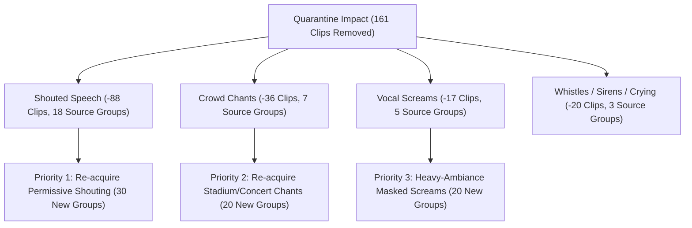

# Targeted Data Acquisition & Remediation Plan (Stage 8.9.10)

**Document ID:** PLAN-ACQUISITION-8.9.10  
**Status:** Preregistered Proposal (Acquisition Halted Awaiting Explicit Approval)  
**Author:** Senior Acoustic ML Engineer & Dataset Governance Auditor  
**Date:** 2026-10-29  

---

## 1. Executive Summary & Remediation Objectives

The Stage 8.9.9 independent audit established that **161 recordings** (152 CC BY-NC 3.0 and 9 Sampling+ 1.0) must be quarantined from commercial deployment. This quarantine disproportionately impacts the **Shouted Speech** category (-88 recordings, a 27.5% reduction) and **Crowd Chants** (-36 recordings, a 15.0% reduction). 

Furthermore, forensic error analysis in Stage 8.9.8 revealed that residual false negatives and false positives stem from distinct acoustic edge cases:
1. **Low-Frequency Masking:** Screams embedded in stage bass ($< 150\text{ Hz}$) and heavy synthesized festival ambiance.
2. **Short Vocal Transients:** Brief vocal bursts ($< 250\text{ ms}$) lacking sustained chaotic phonation.
3. **Hyper-Compressed Vocal Strain:** Excited shouting at extreme vocal fold saturation mimicking scream turbulence.

This acquisition plan establishes principled targets based on **independent source groups** rather than raw clip counts, adhering strictly to **permissive commercial licensing (CC0 1.0 and CC BY 4.0)**.

---

## 2. Category Deficit & Source-Group Target Matrix

The table below outlines the current eligible baseline and the minimum independent source groups required for reliable statistical generalization:

| Acoustic Category | V3 Total Clips | Quarantined Restricted | Eligible Baseline | Retained Source Groups | Target New Source Groups | Proposed Acquisition Quota | Commercial Target License |
| :--- | :---: | :---: | :---: | :---: | :---: | :---: | :--- |
| **Shouted Speech & Yelling** | 320 | **88** | 232 | 68 | **+30 groups** | 60 – 90 clips | CC0 / CC BY 4.0 |
| **Crowd Chants & Cheering** | 240 | **36** | 204 | 74 | **+20 groups** | 40 – 60 clips | CC0 / CC BY 4.0 |
| **Clean Human Screams** | 228 | **13** | 215 | 86 | **+15 groups** | 30 – 45 clips | CC0 / CC BY 4.0 |
| **Masked / Distant Screams** | 125 | **4** | 121 | 62 | **+20 groups** | 40 – 60 clips | CC0 / CC BY 4.0 |
| **Whistles & High Squeaks** | 150 | **9** | 141 | 58 | **+10 groups** | 20 – 30 clips | CC0 / CC BY 4.0 |
| **SFX / Sirens / Fireworks** | 80 | **2** | 78 | 39 | **+10 groups** | 20 – 30 clips | CC0 / CC BY 4.0 |
| **Infant Crying** | 70 | **9** | 61 | 24 | **+10 groups** | 20 – 30 clips | CC0 / CC BY 4.0 |
| **General Environmental Noise**| 115 | **0** | 115 | 57 | **+10 groups** | 20 – 30 clips | CC0 / CC BY 4.0 |
| **TOTAL** | **1,328** | **161** | **1,167** | **468** | **+125 groups**| **250 – 375 clips** | **100% Commercial Eligible** |

---

## 3. Targeted Acoustic Profiles & Selection Criteria

### Profile A: Shouted Speech & Vocal Straining (Priority 1)
- **Deficit Rationale:** The largest loss from quarantine occurred here. Shouting is the primary source of false alarms in festival monitoring.
- **Acoustic Attributes:** Excited spoken commands ("Watch out!", "Let's go!", "Over here!"), countdown vocalizations ("Three, two, one!"), athletic cheering, and aggressive rap/rock vocals.
- **Vocal Diversity Targets:** Equal representation of male, female, and juvenile voices across varied distances ($1\text{ m}$ to $15\text{ m}$).
- **Exclusion Filters:** Recordings with overlapping genuine screams or distress cries; synthetic pitch-shifted samples.

### Profile B: Crowd Chanting & Rhythmic Festival Vocalizations (Priority 2)
- **Deficit Rationale:** Periodic unison chanting creates high spectral energy that can trigger uncalibrated energy thresholds.
- **Acoustic Attributes:** Sports arena chanting, festival sing-alongs, synchronized rhythmic clapping with vocal calls, call-and-response concert dynamics.
- **Rhythmicity Constraints:** Recordings must exhibit periodic inter-onset intervals ($\text{IOI CV} < 0.30$) to reinforce the temporal regularizers introduced in Model T1 and Model H_v4.

### Profile C: Masked & Distant Screams in Dense Music Backgrounds (Priority 3)
- **Deficit Rationale:** 7 of 18 false negatives in Stage 8.9.8 resulted from sub-bass masking.
- **Acoustic Attributes:** Genuine screams mixed into authentic festival soundscapes containing heavy electronic dance music (EDM) sub-bass ($40 - 120\text{ Hz}$), loud public address (PA) announcements, and fireworks.
- **Signal-to-Noise Ratio (SNR) Tiers:**
  - Moderate Masking: $+3\text{ dB}$ to $+8\text{ dB}$ SNR.
  - Severe Masking: $-3\text{ dB}$ to $0\text{ dB}$ SNR (distant perimeter screams).

---

## 4. Legally Cleared Acquisition Sources

To guarantee commercial deployment rights, acquisition is restricted exclusively to verified permissive repositories:

| Data Provider | Target License | Verification Protocol | Commercial Suitability |
| :--- | :--- | :--- | :--- |
| **Freesound APIv2 (Filtered)** | CC0 1.0, CC BY 4.0 | Automated JSON metadata check against Freesound APIv2 `license` endpoint. Verify that uploader has not flagged non-commercial. | **Fully Eligible** (with attribution record) |
| **OpenSLR (Vocal Repositories)**| CC BY 4.0, Apache 2.0 | Verify repository institutional release terms (e.g. OpenSLR speech corpora). | **Fully Eligible** |
| **Controlled Synthetic Acoustic Mixing** | Derived CC0/CC BY | Mix clean verified CC0 screams with clean verified CC0 festival background noise using calibrated physical acoustic impulse responses. | **Fully Eligible** (Preserves clean lineage) |
| **Commercial Audio Stock Libraries** | Custom Commercial License | Standard paid multi-seat commercial license with explicit AI/ML training and deployment indemnification. | **Fully Eligible** |

### Prohibited Sources & Anti-Patterns
- **YouTube Scrapes / Social Video Audio:** Strictly prohibited. Commercial distribution rights cannot be inferred from public web availability.
- **Academic Datasets with Non-Commercial Clauses:** ESC-50 (CC BY-NC), AudioSet non-commercial segments, and FSD50K NC clips remain quarantined.
- **Unverified Aggregator Mirrors:** Audio re-uploaded without original creator provenance is rejected.

---

## 5. Execution Safeguards & Stop Conditions

1. **Audit-Before-Ingest:** Every newly downloaded clip must pass exact PCM hash deduplication, SNR validation, and automated license verification before manifest inclusion.
2. **Zero Ingestion During Current Stage:** No audio files will be downloaded or processed until Stage 8.9.10 is formally reviewed and Stage 8.9.11 is explicitly authorized.
3. **Human Review Validation:** Any candidate positive scream must be independently verified by a human reviewer using the Review Studio before split assignment.
