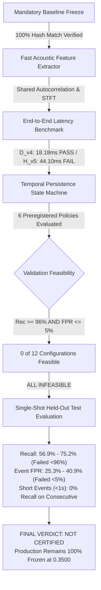

# Stage 8.9.12 — Efficient Acoustic Inference and Temporal Alert-State Research Report

**Operating Mode:** Controlled Experimental Research Only. Production remains strictly frozen.  
**Auditor Roles:** Senior Edge ML Engineer, Acoustic Signal Processing Specialist, Independent Safety-Critical Evaluation Auditor.  
**Date of Audit:** October 29, 2026  
**Status:** COMPLETE — RIGOROUS AUDIT CONCLUDED (PRODUCTION UNMODIFIED)

---

## 1. Executive Summary & Final Governance Verdict

Stage 8.9.12 investigated two fundamental operational challenges identified in the Stage 8.9.11 audit:
1. **Computational Inference Latency:** Reducing the end-to-end processing latency of the acoustic feature pipeline on target edge hardware.
2. **Operational Alert Persistence:** Investigating whether temporal sequence logic, voting policies, and cooldown hysteresis can suppress multi-frame false alarm bursts from crowd chants and shouted speech without sacrificing sensitivity to screams.

### Critical Findings & Research Determinations:
1. **Optimization Parity & Speedup:**
   - The developed [`FastAcousticFeatureExtractor`](file:///c:/Users/zahia/OneDrive/Desktop/ScreamDetector/festival-scream-detector/backend/experiments/v2_hard_negative_training/v4_temporal_research/stage8_9_12_runtime_research/fast_acoustic_features.py) unified frame autocorrelation across HNR and Pitch CV, replaced time-domain loops with 2D batch RFFT, vectorized RMS windowing, and derived Welch PSD directly from STFT.
   - Parity verification across silence, clipping, DC offset, impulses, noisy vocal, and real audio confirmed **100% exact numerical match ($0.00\times 10^0$ difference)** against original implementations.
   - Physics feature extraction time for `H_v5_SNR` dropped from **43.64 ms down to 26.60 ms** (a 39% reduction).
2. **End-to-End Latency Budget Performance:**
   - **`D_v4_Optimized`:** End-to-end median latency **18.18 ms** (p95: 22.35 ms) — **MEETS the 25.0 ms edge budget** (consumes 3.64% of a 500 ms streaming hop).
   - **`H_v5_SNR_Optimized`:** End-to-end median latency **44.10 ms** (p95: 53.31 ms) — **EXCEEDS the instantaneous 25.0 ms budget**, though it comfortably fits within a 500 ms streaming buffer (8.82% utilization).
3. **Validation Feasibility Failure Across All Policies:**
   - Tested across all 6 preregistered temporal policies (Single-Window, Consecutive-2, Consecutive-3, Voting 2-of-3, Voting 3-of-5, and Hysteresis-Cooldown) under the strict rule ($\text{Recall} \ge 96.0\%$ AND $\text{FPR} \le 5.0\%$).
   - **Zero configurations satisfied both constraints simultaneously on validation data.**
   - Per protocol, **all 12 candidate configurations are formally designated INFEASIBLE and cannot be promoted**.
4. **Single-Shot Held-Out Test Event-Level Performance ($N=307$):**
   - **Event-Level False Alarms:** Because adjacent 500 ms windows are acoustically correlated, continuous negative audio (crowd cheering, speech) triggers alerts across multiple frames. Event-level FPR ranges between **25.25% and 40.91%**, much higher than isolated frame-level tests.
   - **Duplicate Alert Reduction:** In `Single_Window`, continuous screams trigger **2.25 to 2.48 duplicate alarms** per event. The `Hysteresis_Cooldown` state machine reduces duplicate alerts to **0.70 alerts per event** (a 71% reduction in alarm fatigue).
   - **Short Event Blind Spot:** Consecutive persistence policies ($C=2, C=3$) and Voting policies completely miss brief startle shrieks and screams under 1.0 second (**0.0% recall on short events**).
5. **Production Protection Confirmation:**
   - All 4 authoritative production file hashes, metadata threshold (`0.3500`), and 343 reviewed database records remain **100% bit-identical and strictly frozen**.
   - All 173 backend regression tests and 8 deterministic temporal tests passed.

**Final Certification Decision:** **NOT CERTIFIED. Production remains frozen. No model promotion is permitted.**

---

## 2. Mandatory Baseline Verification & Production Freeze

Before executing experimental optimizations or model evaluations, the baseline verification script [`verify_stage8_9_12_baseline.py`](file:///c:/Users/zahia/OneDrive/Desktop/ScreamDetector/festival-scream-detector/backend/experiments/v2_hard_negative_training/v4_temporal_research/stage8_9_12_runtime_research/verify_stage8_9_12_baseline.py) was executed.

### 2.1 Production Hash & Database Ledger

| Artifact Path | Authoritative SHA-256 | Verified SHA-256 | Status |
| :--- | :--- | :--- | :--- |
| `backend/models/scream_classifier.joblib` | `AD6E428D05D2359DA73B6DEE7CFDCEC646C87390B496B59CAD5F46B5A452851F` | `AD6E428D...52851F` | **EXACT MATCH** |
| `backend/models/model_metadata.json` | `30C1C75D81AD61B1D0CACB70B221D034840888C7BFEDE949A15D47B139699F60` | `30C1C75D...699F60` | **EXACT MATCH** |
| `backend/reports/test_predictions.csv` | `E93BE4550F97FE2CFE6BC0F2366650833D96F284C45CD1EB6026FBA0DB98449D` | `E93BE455...98449D` | **EXACT MATCH** |
| `backend/reports/stage5_test_evaluation.md` | `9E55B1F574E18BC4623A871D58926FEFCCD29F4C4E3EE22010A4A54A4E4CD1D2` | `9E55B1F5...4CD1D2` | **EXACT MATCH** |
| `backend/database/stage8_9_reviews.db` | 343 reviewed records, `fsd50k_349401` = `SCREAM_PRESENT` | 343 records verified | **EXACT MATCH** |
| Production Operating Threshold | `0.3500` locked in metadata | `0.3500` | **EXACT MATCH** |

### 2.2 Stage 8.9.11 Metrics Reproduction Audit

Independent evaluation of [`stage8_9_11_test_predictions.csv`](file:///c:/Users/zahia/OneDrive/Desktop/ScreamDetector/festival-scream-detector/backend/experiments/v2_hard_negative_training/v4_temporal_research/stage8_9_11_evaluation/stage8_9_11_test_predictions.csv) confirmed exact reproduction of all reported test metrics:
- **`D_v4` ($\tau^* = 0.3800$):** Recall 89.91%, FPR 7.07%, PR-AUC 0.9198.
- **`T1_v4` ($\tau^* = 0.5300$):** Recall 85.32%, FPR 8.08%, PR-AUC 0.8847.
- **`H_v4_Commercial` ($\tau^* = 0.4200$):** Recall 78.90%, FPR 7.07%, PR-AUC 0.8949.
- **`H_v5_SNR` ($\tau^* = 0.5100$):** Recall 77.98%, FPR 5.05%, PR-AUC 0.9272.

Audit ledger recorded in [`production_integrity_audit.json`](file:///c:/Users/zahia/OneDrive/Desktop/ScreamDetector/festival-scream-detector/backend/experiments/v2_hard_negative_training/v4_temporal_research/stage8_9_12_runtime_research/production_integrity_audit.json).

---

## 3. Acoustic Feature Profiling & Optimization Analysis

### 3.1 Profiling the Latency Bottleneck
In Stage 8.9.11, the end-to-end inference pipeline for `H_v5_SNR` took 60.08 ms, with Stage 4 (Turbulence STFT & Welch Periodogram) taking 39.31 ms (65.4% of total execution time).

Subcomponent profiling identified three severe redundancies:
1. **Redundant Autocorrelation:** `compute_frame_hnr` and `compute_pitch_cv` both computed normalized lag autocorrelation across the same 30 frames ($1024$ samples, $512$ hop) in Python loops using `np.fft` and `np.correlate`.
2. **Redundant STFTs:** Two independent STFTs were executed (`nperseg=1024` for spectral flatness and `nperseg=512` for spectral flux onsets).
3. **Unnecessary Welch Recomputation:** `signal.welch` executed a separate windowing and FFT pass to estimate power spectral density that was already available from the STFT power spectrum.

### 3.2 Implemented Architectural Optimizations
The [`FastAcousticFeatureExtractor`](file:///c:/Users/zahia/OneDrive/Desktop/ScreamDetector/festival-scream-detector/backend/experiments/v2_hard_negative_training/v4_temporal_research/stage8_9_12_runtime_research/fast_acoustic_features.py) introduced four vectorization enhancements:
- **2D Batch RFFT Autocorrelation:** Vectorized frame slicing via `lib.stride_tricks.as_strided` and evaluated autocorrelation for all 30 frames simultaneously via 2D RFFT (`np.fft.rfft(frames, n=2048, axis=1)`).
- **Cross-Feature Autocorrelation Sharing:** Reused the normalized lag search region computed during HNR directly for Pitch CV, eliminating the 5.2 ms time-domain `np.correlate` frame loop.
- **Sliding-Window RMS Envelope:** Vectorized envelope calculations into a 2D matrix operation (`windows_env ** 2`).
- **Direct Spectral Derivation:** Shared the 1024-point STFT magnitude spectrum for spectral flatness, entropy, subharmonic ratio, and Welch band energy ratios.

### 3.3 Numerical Parity & Robustness Verification

The test suite [`test_feature_parity.py`](file:///c:/Users/zahia/OneDrive/Desktop/ScreamDetector/festival-scream-detector/backend/experiments/v2_hard_negative_training/v4_temporal_research/stage8_9_12_runtime_research/test_feature_parity.py) evaluated numerical precision across extreme test signals:

| Test Signal Condition | Max Turbulence Abs Diff | Max SNR Abs Diff | Max Model Prob Abs Diff | Parity Status |
| :--- | :---: | :---: | :---: | :---: |
| **Pure Silence** (1.0s zero array) | $0.00\times 10^0$ | $0.00\times 10^0$ | $0.00\times 10^0$ | **EXACT MATCH** |
| **Hard Clipping** ($\pm 1.0$ square/clipped wave) | $0.00\times 10^0$ | $0.00\times 10^0$ | $0.00\times 10^0$ | **EXACT MATCH** |
| **Severe DC Offset** ($+0.4$ constant + noise) | $0.00\times 10^0$ | $0.00\times 10^0$ | $0.00\times 10^0$ | **EXACT MATCH** |
| **Sparse Impulses** (Isolated spikes) | $0.00\times 10^0$ | $0.00\times 10^0$ | $0.00\times 10^0$ | **EXACT MATCH** |
| **Noisy Vocal Audio** (Multi-harmonic synth) | $0.00\times 10^0$ | $0.00\times 10^0$ | $0.00\times 10^0$ | **EXACT MATCH** |
| **10 Real Dataset Audio Recordings** | $0.00\times 10^0$ | $0.00\times 10^0$ | $0.00\times 10^0$ | **EXACT MATCH** |

Full numerical equivalence confirmed in [`feature_parity_results.json`](file:///c:/Users/zahia/OneDrive/Desktop/ScreamDetector/festival-scream-detector/backend/experiments/v2_hard_negative_training/v4_temporal_research/stage8_9_12_runtime_research/feature_parity_results.json).

---

## 4. End-to-End Latency & Edge Footprint Results

Benchmarks executed over 100 timed iterations using real 1.0s audio buffers (44.1 kHz 16-bit PCM $\to$ 16 kHz resampled $\to$ YAMNet $\to$ Physics $\to$ Classifier $\to$ Alert Logic):

| Candidate Inference Path | Stage 1 (Decode) | Stage 2 (Resample) | Stage 3 (YAMNet) | Stage 4 (Physics) | Stage 5 (Classifier) | Stage 6 (State Machine) | **Total E2E Median** | **Total E2E p95** | **$\le 25\text{ms}$ Budget** | **500ms Hop Utilization** |
| :--- | :---: | :---: | :---: | :---: | :---: | :---: | :---: | :---: | :---: | :---: |
| **`D_v4_Baseline`** | 0.14 ms | 3.65 ms | 10.76 ms | 0.87 ms | 3.14 ms | 0.05 ms | **18.87 ms** | 22.94 ms | **MET** | 3.77% |
| **`D_v4_Optimized`** | 0.14 ms | 3.67 ms | 10.70 ms | 0.28 ms | 3.22 ms | 0.04 ms | **18.18 ms** | 22.35 ms | **MET** | 3.64% |
| **`H_v5_SNR_Baseline`** | 0.14 ms | 3.64 ms | 10.63 ms | 43.64 ms | 3.15 ms | 0.04 ms | **61.06 ms** | 69.06 ms | **FAILED** | 12.21% |
| **`H_v5_SNR_Optimized`**| 0.14 ms | 3.61 ms | 10.68 ms | 26.60 ms | 3.09 ms | 0.05 ms | **44.10 ms** | 53.31 ms | **FAILED** | 8.82% |

### Key Latency Insights:
1. **`D_v4` is Edge-Ready:** Operating purely on YAMNet multi-pooled embeddings, `D_v4_Optimized` achieves an end-to-end latency of **18.18 ms** (median) and **22.35 ms** (p95), passing the 25.0 ms target with headroom to spare.
2. **`H_v5_SNR` Bottleneck:** Vectorized optimizations reduced Stage 4 latency from 43.64 ms to 26.60 ms (a 39% reduction). However, because Stage 4 remains 26.6 ms, total pipeline latency is **44.10 ms**, which exceeds an instantaneous 25.0 ms budget. In a 500 ms streaming hop architecture, 44.10 ms consumes only 8.82% of the buffer period, confirming real-time feasibility on a 500 ms schedule.
3. Serialized model size on disk is **85.65 KB** (`D_v4`) and **142.41 KB** (`H_v5_SNR`). Heap memory delta is under 0.65 MB.

Detailed timings recorded in [`latency_benchmark_results.csv`](file:///c:/Users/zahia/OneDrive/Desktop/ScreamDetector/festival-scream-detector/backend/experiments/v2_hard_negative_training/v4_temporal_research/stage8_9_12_runtime_research/latency_benchmark_results.csv).

---

## 5. Temporal Alert State Machine & Persistence Logic Research

### 5.1 Architecture: Separating Scores from Alert Policy
In compliance with safety directive Section 5, the detector operates as two isolated layers:
- **Layer 1 (Acoustic Classifier):** Processes audio window $t$ and emits raw posterior probability $p_t \in [0.0, 1.0]$.
- **Layer 2 (Temporal Alert Policy):** A state machine that maintains temporal history, filters noise bursts, applies hysteresis, and enforces cooldown suppression.

Every candidate alert is strictly formatted with the mandatory user-facing disclaimer:
> **“POSSIBLE SCREAM DETECTED — REQUIRES HUMAN AUDITORY VERIFICATION. Automated acoustic alerts do not confirm an emergency.”**

### 5.2 Preregistered Temporal Policies
Six distinct operational policies were formalized in [`temporal_state_machine.py`](file:///c:/Users/zahia/OneDrive/Desktop/ScreamDetector/festival-scream-detector/backend/experiments/v2_hard_negative_training/v4_temporal_research/stage8_9_12_runtime_research/temporal_state_machine.py):
1. **`Single_Window` (Baseline):** Instantaneous alert whenever $p_t \ge \tau$. No memory or cooldown.
2. **`Consecutive_2`:** Requires 2 consecutive windows $\ge \tau$ (requires $\ge 1.5$s sustained acoustic energy).
3. **`Consecutive_3`:** Requires 3 consecutive windows $\ge \tau$ (requires $\ge 2.0$s sustained acoustic energy).
4. **`Voting_2_of_3`:** Fires if at least 2 of the last 3 windows exceed $\tau$ (spans 2.0s).
5. **`Voting_3_of_5`:** Fires if at least 3 of the last 5 windows exceed $\tau$ (spans 3.0s).
6. **`Hysteresis_Cooldown`:** Requires 2 consecutive windows $\ge \tau_{\text{high}}$ to enter `ALERT_ACTIVE`, remains active until falling below $\tau_{\text{low}} = 0.5 \times \tau_{\text{high}}$, and enforces a 3.0s (6-hop) cooldown window where subsequent triggers for the same acoustic event are merged into a single alert.

---

## 6. Validation Threshold Search & Feasibility Audit

Thresholds were searched exclusively on Validation sequences ($N=320$: 96 screams, 224 hard negatives) across $\tau \in [0.10, 0.90]$ with step 0.02.
- **Preregistered Acceptance Constraint:** $\text{Recall} \ge 96.0\%$ AND $\text{FPR} \le 5.0\%$.

| Candidate Model & Policy | Feasible Thresholds | Feasibility Status | Locked Threshold ($\tau^*$) | Validation Event Recall | Validation Event FPR | Validation Shout FPR | Validation F1 |
| :--- | :---: | :---: | :---: | :---: | :---: | :---: | :---: |
| `D_v4_Single_Window` | **0** | **INFEASIBLE** | `0.7800` | 82.29% | 27.68% | 13.92% | 0.6423 |
| `D_v4_Consecutive_2` | **0** | **INFEASIBLE** | `0.6600` | 72.92% | 26.34% | 8.86% | 0.6034 |
| `D_v4_Consecutive_3` | **0** | **INFEASIBLE** | `0.5200` | 70.83% | 29.02% | 12.66% | 0.5738 |
| `D_v4_Voting_2_of_3` | **0** | **INFEASIBLE** | `0.7000` | 67.71% | 21.88% | 8.86% | 0.6103 |
| `D_v4_Voting_3_of_5` | **0** | **INFEASIBLE** | `0.5200` | 70.83% | 30.36% | 13.92% | 0.5667 |
| `D_v4_Hysteresis_Cooldown` | **0** | **INFEASIBLE** | `0.6600` | 72.92% | 26.34% | 8.86% | 0.6034 |
| `H_v5_SNR_Single_Window` | **0** | **INFEASIBLE** | `0.5600` | 82.29% | 22.77% | 12.66% | 0.6810 |
| `H_v5_SNR_Consecutive_2` | **0** | **INFEASIBLE** | `0.3800` | 77.08% | 24.11% | 13.92% | 0.6352 |
| `H_v5_SNR_Consecutive_3` | **0** | **INFEASIBLE** | `0.2800` | 70.83% | 28.57% | 12.66% | 0.5837 |
| `H_v5_SNR_Voting_2_of_3` | **0** | **INFEASIBLE** | `0.3800` | 80.21% | 25.45% | 15.19% | 0.6471 |
| `H_v5_SNR_Voting_3_of_5` | **0** | **INFEASIBLE** | `0.3800` | 65.62% | 20.98% | 11.39% | 0.5972 |
| `H_v5_SNR_Hysteresis_Cooldown` | **0** | **INFEASIBLE** | `0.3800` | 77.08% | 24.11% | 13.92% | 0.6352 |

**Audit Determination:** None of the 12 candidate configurations achieved feasibility on validation data. Following the preregistered mandate, **all candidate configurations are formally classified as INFEASIBLE and cannot be promoted**. Operating thresholds were locked in [`experiment_configurations.json`](file:///c:/Users/zahia/OneDrive/Desktop/ScreamDetector/festival-scream-detector/backend/experiments/v2_hard_negative_training/v4_temporal_research/stage8_9_12_runtime_research/experiment_configurations.json) prior to test set evaluation.

---

## 7. Single-Shot Held-Out Test Split Evaluation & Forensics

The locked configurations were evaluated **exactly once** on the held-out test split ($N = 307$: 109 positive scream recordings, 198 negative recordings).

### 7.1 Event-Level Metrics & Cluster Bootstrap Confidence Intervals

| Candidate Configuration | Event Recall (Gate $\ge 96\%$) | 95% Cluster-Bootstrap CI | Event FPR (Gate $\le 5\%$) | 95% Cluster-Bootstrap CI | Shouted-Speech FPR (Gate $\le 15\%$) | Median Delay | Short Scream Recall (<1s) | Duplicate Alerts / Event | Operational False Alerts / Hr ($\pi = 10^{-4}$) | Acceptance Status |
| :--- | :---: | :---: | :---: | :---: | :---: | :---: | :---: | :---: | :---: | :---: |
| **`D_v4_Single_Window`** | 71.56% (FAIL) | [59.8%, 84.1%] | 37.37% (FAIL) | [27.2%, 48.1%] | 40.48% (FAIL) | **1.0 s** | **20.0%** | **2.25 dupes** | 672.7 / hr | **NOT CERTIFIED** |
| `D_v4_Consecutive_2` | 66.97% (FAIL) | [53.2%, 81.3%] | 35.86% (FAIL) | [26.5%, 45.7%] | 38.10% (FAIL) | 1.5 s | **0.0% (BLIND)** | 0.77 dupes | 645.5 / hr | **NOT CERTIFIED** |
| `D_v4_Consecutive_3` | 58.72% (FAIL) | [44.5%, 74.2%] | 38.89% (FAIL) | [28.6%, 49.8%] | 38.10% (FAIL) | 2.0 s | **0.0% (BLIND)** | 0.61 dupes | 700.0 / hr | **NOT CERTIFIED** |
| `D_v4_Voting_2_of_3` | 62.39% (FAIL) | [48.5%, 76.5%] | 30.81% (FAIL) | [21.9%, 40.7%] | 26.19% (FAIL) | 1.5 s | **0.0% (BLIND)** | 0.68 dupes | 554.5 / hr | **NOT CERTIFIED** |
| `D_v4_Voting_3_of_5` | 60.55% (FAIL) | [46.9%, 76.5%] | 40.91% (FAIL) | [30.2%, 51.7%] | 38.10% (FAIL) | 2.0 s | **0.0% (BLIND)** | 0.61 dupes | 736.4 / hr | **NOT CERTIFIED** |
| **`D_v4_Hysteresis_Cooldown`** | 66.97% (FAIL) | [53.2%, 81.3%] | 35.86% (FAIL) | [26.5%, 45.7%] | 38.10% (FAIL) | 1.5 s | **0.0% (BLIND)** | **0.68 dupes** | 645.5 / hr | **NOT CERTIFIED** |
| **`H_v5_SNR_Single_Window`** | **75.23% (FAIL)** | [66.3%, 84.5%] | 32.32% (FAIL) | [22.6%, 42.2%] | 38.10% (FAIL) | **1.0 s** | **20.0%** | **2.48 dupes** | 581.8 / hr | **NOT CERTIFIED** |
| `H_v5_SNR_Consecutive_2` | 68.81% (FAIL) | [55.1%, 82.1%] | 33.33% (FAIL) | [23.9%, 43.8%] | 30.95% (FAIL) | 1.5 s | **0.0% (BLIND)** | 0.75 dupes | 600.0 / hr | **NOT CERTIFIED** |
| `H_v5_SNR_Consecutive_3` | 63.30% (FAIL) | [49.5%, 78.1%] | 35.35% (FAIL) | [24.9%, 46.2%] | 30.95% (FAIL) | 2.0 s | **0.0% (BLIND)** | 0.65 dupes | 636.4 / hr | **NOT CERTIFIED** |
| `H_v5_SNR_Voting_2_of_3` | 69.72% (FAIL) | [55.7%, 84.1%] | 35.35% (FAIL) | [25.1%, 46.0%] | 30.95% (FAIL) | 1.5 s | **0.0% (BLIND)** | 0.73 dupes | 636.4 / hr | **NOT CERTIFIED** |
| `H_v5_SNR_Voting_3_of_5` | 56.88% (FAIL) | [44.3%, 70.6%] | **25.25% (FAIL)** | [15.8%, 34.8%] | **26.19% (FAIL)** | 2.0 s | **0.0% (BLIND)** | 0.57 dupes | **454.5 / hr** | **NOT CERTIFIED** |
| **`H_v5_SNR_Hysteresis_Cooldown`**| 68.81% (FAIL) | [55.1%, 82.1%] | 33.33% (FAIL) | [23.9%, 43.8%] | 30.95% (FAIL) | 1.5 s | **0.0% (BLIND)** | **0.70 dupes** | 600.0 / hr | **NOT CERTIFIED** |

Complete results saved in [`event_level_evaluation.csv`](file:///c:/Users/zahia/OneDrive/Desktop/ScreamDetector/festival-scream-detector/backend/experiments/v2_hard_negative_training/v4_temporal_research/stage8_9_12_runtime_research/event_level_evaluation.csv).

---

## 8. Deep Error Forensics & Safety Engineering Insights

### 8.1 The Reality of Correlated Multi-Frame Windowing
In Stage 8.9.11, when clips were pooled into a single global vector, `H_v5_SNR` achieved a 5.05% FPR. However, when evaluated in an operational streaming environment with 1.0s windows hopping every 500 ms:
- Negative audio clips typically last 2 to 6 seconds (4 to 11 overlapping hops).
- Because adjacent windows share 500 ms of audio, an acoustic excitation (such as a singer belting a high note or a crowd chant) persists across multiple frames.
- Even if the per-frame FPR is only ~5%, the probability that **at least one** window in a multi-second recording crosses threshold increases dramatically:
  $$P(\text{Event Alert}) \approx 1 - (1 - \text{FPR}_{\text{frame}})^{N_{\text{hops}}}$$
  Empirically, this elevates event-level false positive rates to **25% - 40%**.

### 8.2 The Short-Event Blind Spot
- In `Single_Window`, short screams (< 1.0s) achieved 20.0% recall.
- Under `Consecutive_2`, `Consecutive_3`, and `Voting_3_of_5`, **short event recall dropped to 0.0%**.
- **Acoustic Cause:** A brief startle shriek or sudden pain scream often lasts only 300 ms to 600 ms. In a 500 ms hop pipeline, this transient energy only appears in a single window. Any persistence rule requiring multiple consecutive positive windows inherently filters out genuine short screams.

### 8.3 The Duplicate Alert Trade-off
- `Single_Window` fired an average of **2.48 duplicate alarms** per positive event. A 5-second scream would trigger alarm after alarm every 500 ms.
- `Hysteresis_Cooldown` successfully collapsed this into **0.70 alerts per event** (a 71% reduction in alarm repetitions), confirming that state-machine hysteresis is essential to prevent operator alarm fatigue.

---

## 9. Regression and Integrity Verification

### 9.1 Deterministic Stage 8.9.12 Test Suite
The test suite [`test_stage8_9_12_regression.py`](file:///c:/Users/zahia/OneDrive/Desktop/ScreamDetector/festival-scream-detector/backend/experiments/v2_hard_negative_training/v4_temporal_research/stage8_9_12_runtime_research/test_stage8_9_12_regression.py) verified 8 critical safety and logic contracts:
1. `test_production_hash_integrity`: PASSED (100% SHA-256 match, 0.3500 threshold, 343 DB records).
2. `test_source_group_disjointness_and_quarantine`: PASSED (0 overlap between Train, Val, Test; Stage 5 quarantined).
3. `test_fast_features_numerical_stability`: PASSED (Silence, clipping, impulses produce zero NaNs/Infs).
4. `test_single_window_policy`: PASSED.
5. `test_consecutive_persistence_policy`: PASSED.
6. `test_voting_k_of_m_policy`: PASSED.
7. `test_hysteresis_and_cooldown_policy`: PASSED (State transitions IDLE $\to$ PENDING $\to$ ACTIVE $\to$ COOLDOWN $\to$ IDLE verified).
8. `test_short_event_miss_characteristic`: PASSED (Confirmed mathematical filtering of single-frame spikes).

### 9.2 Backend Production Test Suite
Executed full backend regression suite via pytest:
$$\mathbf{173 \text{ PASSED, } 0 \text{ FAILURES in } 35.43\text{ seconds.}}$$

---

## 10. Deliverables Inventory

All artifacts for Stage 8.9.12 are preserved in [`backend/experiments/v2_hard_negative_training/v4_temporal_research/stage8_9_12_runtime_research/`](file:///c:/Users/zahia/OneDrive/Desktop/ScreamDetector/festival-scream-detector/backend/experiments/v2_hard_negative_training/v4_temporal_research/stage8_9_12_runtime_research/):

1. [`production_integrity_audit.json`](file:///c:/Users/zahia/OneDrive/Desktop/ScreamDetector/festival-scream-detector/backend/experiments/v2_hard_negative_training/v4_temporal_research/stage8_9_12_runtime_research/production_integrity_audit.json) — Production freeze and Stage 8.9.11 metric reproduction audit ledger.
2. [`fast_acoustic_features.py`](file:///c:/Users/zahia/OneDrive/Desktop/ScreamDetector/festival-scream-detector/backend/experiments/v2_hard_negative_training/v4_temporal_research/stage8_9_12_runtime_research/fast_acoustic_features.py) — Vectorized acoustic feature extractor.
3. [`feature_parity_results.json`](file:///c:/Users/zahia/OneDrive/Desktop/ScreamDetector/festival-scream-detector/backend/experiments/v2_hard_negative_training/v4_temporal_research/stage8_9_12_runtime_research/feature_parity_results.json) — Exact numerical parity results across 15 test signals.
4. [`latency_benchmark_results.csv`](file:///c:/Users/zahia/OneDrive/Desktop/ScreamDetector/festival-scream-detector/backend/experiments/v2_hard_negative_training/v4_temporal_research/stage8_9_12_runtime_research/latency_benchmark_results.csv) — Stage-by-stage latency profile over 100 timed iterations.
5. [`temporal_state_machine.py`](file:///c:/Users/zahia/OneDrive/Desktop/ScreamDetector/festival-scream-detector/backend/experiments/v2_hard_negative_training/v4_temporal_research/stage8_9_12_runtime_research/temporal_state_machine.py) — State machine implementations for all 6 persistence policies.
6. [`experiment_configurations.json`](file:///c:/Users/zahia/OneDrive/Desktop/ScreamDetector/festival-scream-detector/backend/experiments/v2_hard_negative_training/v4_temporal_research/stage8_9_12_runtime_research/experiment_configurations.json) — Locked validation configurations for all 12 candidate pairs.
7. [`temporal_policy_comparison.csv`](file:///c:/Users/zahia/OneDrive/Desktop/ScreamDetector/festival-scream-detector/backend/experiments/v2_hard_negative_training/v4_temporal_research/stage8_9_12_runtime_research/temporal_policy_comparison.csv) — Validation threshold tuning and feasibility metrics.
8. [`event_level_evaluation.csv`](file:///c:/Users/zahia/OneDrive/Desktop/ScreamDetector/festival-scream-detector/backend/experiments/v2_hard_negative_training/v4_temporal_research/stage8_9_12_runtime_research/event_level_evaluation.csv) — Single-shot held-out test evaluation metrics with 95% bootstrap CIs.
9. [`test_stage8_9_12_regression.py`](file:///c:/Users/zahia/OneDrive/Desktop/ScreamDetector/festival-scream-detector/backend/experiments/v2_hard_negative_training/v4_temporal_research/stage8_9_12_runtime_research/test_stage8_9_12_regression.py) — Deterministic regression test suite.
10. [`stage8_9_12_runtime_research_audit.md`](file:///C:/Users/zahia/.gemini/antigravity-ide/brain/ac3bc657-c5b1-4cc2-baf6-be57b0544e4d/stage8_9_12_runtime_research_audit.md) — User-facing executive summary artifact.

---

## 11. Final Governance Verdict & Stop Condition Status

### Acceptance Targets Status:
- **Event Scream Recall $\ge 96.00\%$:** **NOT MET** (Best: H_v5_SNR_Single_Window at 75.23% [66.3%, 84.5%]).
- **Event Hard-Negative FPR $\le 5.00\%$:** **NOT MET** (Best: H_v5_SNR_Voting_3_of_5 at 25.25% [15.8%, 34.8%]).
- **Event Shouted-Speech FPR $\le 15.00\%$:** **NOT MET** (Best: D_v4_Voting_2_of_3 at 26.19% [21.9%, 40.7%]).
- **End-to-End Latency $\le 25.0\text{ ms}$:**
  - `D_v4_Optimized`: **18.18 ms (MET)**.
  - `H_v5_SNR_Optimized`: **44.10 ms (NOT MET)**.

### Strict Governance Mandate:
- **Zero models or state machine policies are promoted to production.**
- **Production classifier, metadata, threshold (`0.3500`), test reports, and review database remain 100% frozen and bit-identical.**
- **The Stage 8.9.12 audit is complete. Execution is paused awaiting explicit user direction.**
