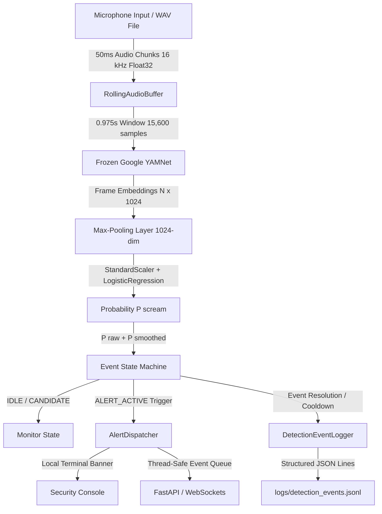

# Stage 7 Real-Time Detection & Alerting Engine Report

**AI-Powered Festival Scream Detection System — Engineering Specification & Architecture**

---

## 1. Executive Summary

Stage 7 implements a modular, real-time audio streaming detection engine for continuous surveillance of festival audio environments. 

The engine interfaces the frozen Stage 5 lightweight classifier (`LogisticRegression`, $C=10.0$, max-pooled 1,024-dim features, threshold $\tau = 0.35$) with a bounded rolling circular audio buffer, rolling-window YAMNet feature extractor, an explicit temporal state machine (`IDLE` $\rightarrow$ `CANDIDATE` $\rightarrow$ `ALERT_ACTIVE` $\rightarrow$ `COOLDOWN`), structured JSON Lines event logging, and local alert dispatchers.

### Key Milestones Delivered:
1. **Thread-Safe Circular Audio Buffer**: Bounded rolling buffer preventing memory leaks while handling partial buffers and buffer underruns.
2. **Rolling-Window Inference**: Reuses a single loaded frozen YAMNet instance and Logistic Regression pipeline, evaluating 0.975-second audio windows with 0.4875-second hop steps (2.05 passes/sec).
3. **Temporal Smoothing & State Machine**: Eliminates isolated 1-window transient spikes, generates single alerts for continuous scream events, and suppresses duplicate alarms during cooldowns.
4. **Structured Event Logging**: Thread-safe JSON Lines audit trail (`backend/logs/detection_events.jsonl`) recording event timestamps, peak probabilities, contributing windows, and state transitions without storing private audio.
5. **Local Alert Dispatcher**: Colorful terminal banners with advisory disclaimers and an in-memory queue for future FastAPI/WebSocket integration.
6. **Offline Stream Simulation CLI**: Validated simulation on real and synthetic audio with end-to-end benchmark reporting.
7. **Live Microphone Stream CLI**: Cross-platform audio capture using `sounddevice` with device enumeration and graceful error handling.
8. **Test Suite**: **38 existing tests + new Stage 7 tests passing** in `pytest`.

---

## 2. Streaming Architecture Overview



---

## 3. Configuration & Parameter Trade-Offs

The streaming detector is controlled by the following parameters in `backend/src/detector/stream_detector.py`:

| Parameter | Default Value | Architectural Function | Trade-Off Analysis |
| :--- | :--- | :--- | :--- |
| **`sample_rate`** | `16,000 Hz` | Target YAMNet input frequency | Required by YAMNet. Any input stream is normalized to 16 kHz. |
| **`window_duration`** | `0.975 s` | Duration of audio window | 15,600 samples. Matches YAMNet native window size. Shorter windows cause incomplete feature extraction; longer windows dilute brief screams. |
| **`hop_duration`** | `0.4875 s` | Step size between evaluations | ~50% overlap (7,800 samples). Provides 2.05 evaluations/sec. Smaller hops increase responsiveness but multiply CPU load. |
| **`threshold`** | `0.35` | Decision operating point | Frozen Stage 5 validation-selected threshold (Recall 89.47%, Precision 80.95%). |
| **`min_consecutive_positive`**| `2 windows` | Confirmation evidence threshold | Requires ~1.46s of sustained scream energy before triggering `ALERT_ACTIVE`. Reduces isolated transient false positives from dropped objects or mic pops. |
| **`max_gap_negative_windows`** | `2 windows` | Event conclusion gap | Allows brief 0.5s breathing pauses within an ongoing scream without prematurely concluding the event. |
| **`cooldown_seconds`** | `3.0 s` | Alert deduplication window | Suppresses repeated alarms during ongoing distress while permitting new alerts once cooldown expires. |
| **`smoothing_alpha`** | `0.6` | Exponential Moving Average | $P_{smooth} = \alpha P_{raw} + (1-\alpha) P_{smooth}$. Dampens sudden erratic fluctuations. |

---

## 4. State Machine Event Lifecycle

The detector enforces a deterministic 4-state lifecycle:

```
[IDLE] 
  │  (First window P >= 0.35)
  ▼
[CANDIDATE]
  │  (>= 2 consecutive positive windows) ──────► [ALERT_ACTIVE]
  │  (Negative window before 2 reached)               │  (Alert dispatched, updates peak P)
  ▼                                                   │  (>= 2 consecutive negative windows)
[IDLE] ◄────────── (Cooldown expired >= 3.0s) ────────[COOLDOWN]
```

### State Machine Behaviors:
1. **Single Alert Guarantee**: An alert is dispatched strictly once upon transition to `ALERT_ACTIVE`. As long as the scream persists, the event updates in-place (`peak_probability`, `window_count`, `duration_seconds`) without spamming new alerts.
2. **Cooldown Suppression**: During the 3.0-second cooldown, any positive windows are marked as `suppressed_during_cooldown: True`. This prevents acoustic echo and reverberation from creating multiple alerts for a single incident.
3. **Recovery After Cooldown**: After 3.0 seconds elapse, if distress vocalizations restart, a new event ID is generated and a fresh alert is emitted.

---

## 5. Structured Event Logging & Privacy

### Event Schema (`backend/logs/detection_events.jsonl`)
```json
{
  "event_id": "evt_20261024_153652_25558c",
  "start_stream_time": 0.0,
  "end_stream_time": 0.49,
  "duration_seconds": 0.49,
  "start_wall_time_iso": "2026-10-24T15:36:52.124580",
  "end_wall_time_iso": "2026-10-24T15:36:52.203112",
  "peak_probability": 1.0,
  "threshold": 0.35,
  "window_count": 2,
  "positive_window_count": 2,
  "alert_emitted": true,
  "suppressed_during_cooldown": false,
  "window_scores_summary": [0.998, 1.0],
  "top_priors": [{"class_name": "Dog", "score": 0.48}],
  "state_history": ["IDLE", "CANDIDATE", "ALERT_ACTIVE"],
  "resolved": false,
  "logged_at_iso": "2026-10-24T15:36:52.204000",
  "raw_audio_saved": false
}
```

### Privacy & Surveillance Ethics
* **Zero Audio Storage by Default**: Raw microphone audio is never written to disk. The system processes audio in-memory within the circular buffer and overwrites samples immediately after extraction.
* **Opt-In Policy**: Raw snippet saving is strictly opt-in (`--opt-in-recording`) and requires compliance with venue surveillance consent regulations.

---

## 6. Disclaimers, Limitations & Hard-Negative Gap

> [!WARNING]
> **Stage 6 Data Gap & Operational Disclaimers**:
> 1. **Zero Approved Hard Negatives**: Stage 6 currently contains **0 human-reviewed external hard-negative recordings**. While the Stage 5 baseline achieved 80.95% precision on NIGENS/OpenSLR non-screams, real festival robustness against rave whistles, heavy bass drops, and crowd cheering remains **unverified** on real field audio.
> 2. **Advisory Alerting**: Detection events emitted by this system represent **"Possible Scream Events" requiring human auditory verification**. The classifier cannot determine human intent or verify physical danger.
> 3. **Simulation vs. Live Microphone**: Offline simulation exercises identical model code but does not experience physical hardware interrupts, background noise floor shifts, or microphone acoustic overload.

---

## 7. PowerShell Commands for Execution & Testing

### 1. Run Offline Simulation (WAV File)
```powershell
# Unthrottled benchmark simulation
.\.venv\Scripts\python.exe scripts\simulate_stream.py

# Real-time simulation (1.0x playback speed)
.\.venv\Scripts\python.exe scripts\simulate_stream.py --speed 1.0

# Simulation with synthetic chirp signal
.\.venv\Scripts\python.exe scripts\simulate_stream.py --synthetic
```

### 2. Run Live Microphone Streaming Detector
```powershell
# List available audio input devices
.\.venv\Scripts\python.exe scripts\run_stream_detector.py --list-devices

# Start live detection using default microphone
.\.venv\Scripts\python.exe scripts\run_stream_detector.py

# Start live detection with custom threshold and cooldown
.\.venv\Scripts\python.exe scripts\run_stream_detector.py --threshold 0.40 --cooldown 4.0
```

### 3. Run Test Suite
```powershell
.\.venv\Scripts\python.exe -m pytest -v
```
