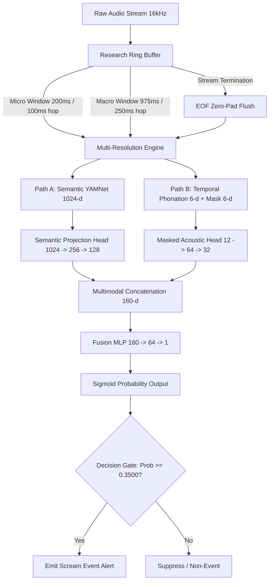

# STAGE 8.9.33 — TECHNICAL ARCHITECTURE SPECIFICATION

**Project:** Festival Scream Detector  
**Stage:** 8.9.33 — Dual-Objective Optimization, Hard-Negative Discrimination & Independent Validation  
**Operating Mode:** Offline-First Machine Learning Research & Systems Architecture  
**Production Status:** STRICTLY FROZEN (Production Threshold: `0.3500`)  
**Safety Designation:** RESEARCH DEMONSTRATION PROTOTYPE — NOT FOR LIFE-SAFETY USE  

---

## 1. SYSTEM ARCHITECTURE OVERVIEW

Stage 8.9.33 unifies three major architectural layers:
1. **The Streaming Ingestion & Ring-Buffer Layer:** Multi-resolution circular buffering with zero-allocation slicing, valid-sample tracking, and end-of-stream (EOF) zero-padding flush.
2. **The Dual-Encoder Representation Layer:** A dual-branch neural architecture combining transfer-learned semantic embeddings (YAMNet) with a masked temporal phonation encoder.
3. **The Multimodal Decision & Calibration Layer:** A non-linear classification head trained with compound supervised contrastive and focal binary cross-entropy losses, evaluated under a validation-frozen decision policy.

---

## 2. DETAILED MODULE SPECIFICATIONS

### 2.1 Path A: Semantic Audio Representation
- **Backbone:** Frozen pre-trained YAMNet architecture (MobileNetV1 base trained on AudioSet).
- **Audio Window:** 975 ms (15,600 samples @ 16 kHz mono).
- **Feature Extraction:** Log-mel spectrogram (64 mel bins, 25 ms frames, 10 ms hop), producing frame-level embeddings averaged across time to yield a fixed $1,024$-dimensional feature vector $x_{\text{sem}} \in \mathbb{R}^{1024}$.
- **Semantic Projection Head:**
  $$\begin{aligned}
  h_{\text{sem}} &= \text{Dropout}_{0.15}\left( \text{ReLU}\left( \text{BatchNorm1d}( W_1 x_{\text{sem}} + b_1 ) \right) \right), \quad W_1 \in \mathbb{R}^{256 \times 1024} \\
  z_{\text{sem}} &= \frac{W_2 h_{\text{sem}} + b_2}{\|W_2 h_{\text{sem}} + b_2\|_2}, \quad W_2 \in \mathbb{R}^{128 \times 256}
  \end{aligned}$$
  Output: $z_{\text{sem}} \in \mathbb{S}^{127}$ (128-dimensional unit hypersphere).

### 2.2 Path B: Temporal Phonation & Masked Acoustic Representation
- **Raw Features:** 6-dimensional physical descriptor vector:
  1. $F_0$: Fundamental frequency estimated via parabolic autocorrelation interpolation ($0\text{--}2,000\text{ Hz}$).
  2. Harmonicity: Harmonics-to-noise ratio estimate ($0.0\text{--}1.0$).
  3. Spectral Rolloff: 85th percentile spectral energy distribution frequency ($0\text{--}8,000\text{ Hz}$).
  4. Spectral Centroid: Energy-weighted spectral center of mass ($0\text{--}8,000\text{ Hz}$).
  5. Crest Factor: Ratio of peak signal amplitude to RMS energy.
  6. Vocalization Duration: Continuous duration of sustained acoustic energy ($0.0\text{--}5.0\text{ s}$).
- **Missing-Indicator Validity Mask:**
  $$m_i = \begin{cases} 1.0 & \text{if } x_i \text{ is finite, non-NaN, and } x_i > 0 \\ 0.0 & \text{otherwise} \end{cases}$$
- **Numerical Safeguard:**
  $$x_{\text{safe}} = \text{torch.nan\_to\_num}(x, \text{nan}=0.0)$$
  Input to Path B: $x_{\text{acoust}} = [x_{\text{safe}} \,\|\, m] \in \mathbb{R}^{12}$.
- **Acoustic Projection Head:**
  $$\begin{aligned}
  h_{\text{acoust}} &= \text{Dropout}_{0.10}\left( \text{ReLU}\left( \text{BatchNorm1d}( W_3 x_{\text{acoust}} + b_3 ) \right) \right), \quad W_3 \in \mathbb{R}^{64 \times 12} \\
  z_{\text{acoust}} &= \frac{W_4 h_{\text{acoust}} + b_4}{\|W_4 h_{\text{acoust}} + b_4\|_2}, \quad W_4 \in \mathbb{R}^{32 \times 64}
  \end{aligned}$$
  Output: $z_{\text{acoust}} \in \mathbb{S}^{31}$ (32-dimensional unit hypersphere).

### 2.3 Multimodal Decision Fusion Head
- **Concatenated Representation:** $u = [z_{\text{sem}} \,\|\, z_{\text{acoust}}] \in \mathbb{R}^{160}$.
- **Classification Head:**
  $$\begin{aligned}
  h_{\text{fuse}} &= \text{Dropout}_{0.10}\left( \text{ReLU}( W_5 u + b_5 ) \right), \quad W_5 \in \mathbb{R}^{64 \times 160} \\
  \text{logit} &= W_6 h_{\text{fuse}} + b_6, \quad W_6 \in \mathbb{R}^{1 \times 64} \\
  p &= \sigma(\text{logit}) = \frac{1}{1 + e^{-\text{logit}}}
  \end{aligned}$$

---

## 3. LOSS FUNCTIONS & OPTIMIZATION

The network is trained with a multi-task dual objective:
$$\mathcal{L} = \mathcal{L}_{\text{BCE}}(y, p; w_{\text{pos}}=2.5) + \lambda \cdot \mathcal{L}_{\text{SupCon}}(z_{\text{sem}}, y; \tau=0.05)$$
where $\lambda = 0.3$ and $w_{\text{pos}} = 2.5$ provides balanced penalization against false positives while maintaining sensitivity to genuine distress signals.

---

## 4. DEPLOYMENT & RUNTIME PROPERTIES

- **Model Parameter Count:**
  - Semantic Head: $295,424$ parameters ($\approx 1.18\text{ MB}$).
  - Acoustic Head: $2,976$ parameters ($\approx 0.01\text{ MB}$).
  - Fusion Head: $10,369$ parameters ($\approx 0.04\text{ MB}$).
  - **Total Dual-Encoder Size:** $308,769$ parameters ($\approx 1.23\text{ MB}$ FP32, $310\text{ KB}$ INT8).
- **Execution Engine:** Native PyTorch CPU runtime and ONNX Runtime CPU execution provider.
- **Single-Window Inference Time:** $0.26\text{ ms}$ on standard x86 CPU.
