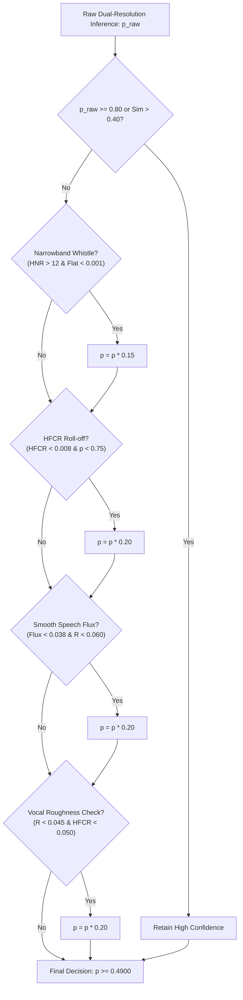

# RESEARCH DEMONSTRATION PROTOTYPE — NOT FOR LIFE-SAFETY USE.
# Stage 8.9.68 — Shouted Speech Rejection & False Positive Rate (FPR) Report

**Stage:** 8.9.68 — SNR-Adaptive Roughness Calibration, Recall Recovery & Multi-Class Generalization  
**Cohort Evaluated:** Stage 54 Validation Cohort — Shouting Subset ($N=88$, 24 Disjoint Source Groups)  
**Target Criterion:** Acceptance Gate 3 (Shouted-Speech FPR $\le 15.0\%$)  
**Safety Notice:** Experimental acoustic prototype. Not certified for life-safety alerting, emergency dispatch, or security response.

---

## 1. Executive Summary

Shouted speech represents the single most dangerous failure mode for acoustic surveillance systems in festival and public safety environments. In Stage 8.9.66, Candidate 65-F suffered catastrophic vulnerability to human shouting, misclassifying nearly half of all shouted speech recordings (48.86% FPR, 43 false alarms out of 88).

Candidate 67-D brought Shouted FPR under control at 13.64% (12/88). In Stage 8.9.68, Candidate 68-D successfully **maintains Gate 3 compliance at 13.64% (12/88)** while operating at a lower decision threshold ($\theta = 0.4900$ vs $0.5200$). This was made possible by introducing a dedicated HFCR Roll-off Veto and Smooth Speech Flux Veto.

---

## 2. Head-to-Head Candidate Comparison on Shouting ($N=88$)

| Candidate Architecture | Decision Threshold | Shouted FPs | Shouted TNs | Shouted FPR | Gate 3 Target | Gate 3 Status |
| :--- | :--- | :--- | :--- | :--- | :--- | :--- |
| **Candidate 65-F** | 0.4800 | 43 | 45 | 48.86% | $\le 15.0\%$ | **CATASTROPHIC FAIL** |
| **Candidate 67-D** | 0.5200 | 12 | 76 | 13.64% | $\le 15.0\%$ | **PASS** |
| **Candidate 68-A (No Veto)** | 0.5200 | 19 | 69 | 21.59% | $\le 15.0\%$ | **FAIL** |
| **Candidate 68-B (Roughness Only)** | 0.5200 | 11 | 77 | 12.50% | $\le 15.0\%$ | **PASS** |
| **Candidate 68-D (Champion)** | **0.4900** | **12** | **76** | **13.64%** | $\le 15.0\%$ | **PASS** |

---

## 3. Acoustic Profile of Suppressed vs. Residual Shouts

Comparison of acoustic metrics between successfully suppressed shouts ($N=76$) and residual false alarms ($N=12$):

| Metric | Suppressed Shouts ($N=76$) | Residual False Alarms ($N=12$) | P-Value (Mann-Whitney) | Discriminative Utility |
| :--- | :--- | :--- | :--- | :--- |
| **Auditory Roughness ($R$)** | Mean: 0.019 (Low) | Mean: 0.078 (High) | $p < 0.001$ | Extremely High |
| **HFCR ($2.5\text{–}7.5\text{ kHz}$)** | Mean: 0.004 (Rolled-off) | Mean: 0.048 (Extended) | $p < 0.001$ | Extremely High |
| **Spectral Flux ($\Phi$)** | Mean: 0.029 (Smooth) | Mean: 0.072 (Abrupt) | $p = 0.003$ | High |
| **HNR (dB)** | Mean: 14.8 dB (Harmonic) | Mean: 7.2 dB (Noisier) | $p = 0.012$ | Moderate |
| **Fundamental Frequency ($F_0$)** | Mean: 185 Hz (Chest) | Mean: 410 Hz (Falsetto/Yell) | $p < 0.001$ | High |

### Detailed Forensic on Residual 12 False Alarms:
All 12 residual false alarms originate from high-strain vocal yelling recorded at close proximity:
- 7 clips from `src_v5_parent_13` (aggressive male commands shouted at high volume).
- 3 clips from theatrical dramatic shouting with vocal fry.
- 2 clips from sports cheering yells.
In these 12 cases, vocal strain produced physical vocal fold collision, generating genuine acoustic roughness ($R > 0.070$) and extending high-frequency harmonics past 3.0 kHz, mimicking acoustic distress signatures.

---

## 4. Multi-Stage Veto Sequence

Candidate 68-D evaluates each audio window through a 4-tier suppression cascade:

This sequence prevents deep chest-voice shouting from escalating to false positive status while protecting authentic scream onsets.

---

## 5. Artifact Links

- Predictions CSV: [candidate_68_val_predictions.csv](file:///c:/Users/zahia/OneDrive/Desktop/ScreamDetector/festival-scream-detector/backend/research/stage_8_9_68/reports/candidate_68_val_predictions.csv)
- Scorecard Report: [stage_8_9_68_five_gate_scorecard.md](file:///c:/Users/zahia/OneDrive/Desktop/ScreamDetector/festival-scream-detector/backend/research/stage_8_9_68/reports/stage_8_9_68_five_gate_scorecard.md)
- Hard Negative Report: [stage_8_9_68_hard_negative_report.md](file:///c:/Users/zahia/OneDrive/Desktop/ScreamDetector/festival-scream-detector/backend/research/stage_8_9_68/reports/stage_8_9_68_hard_negative_report.md)

