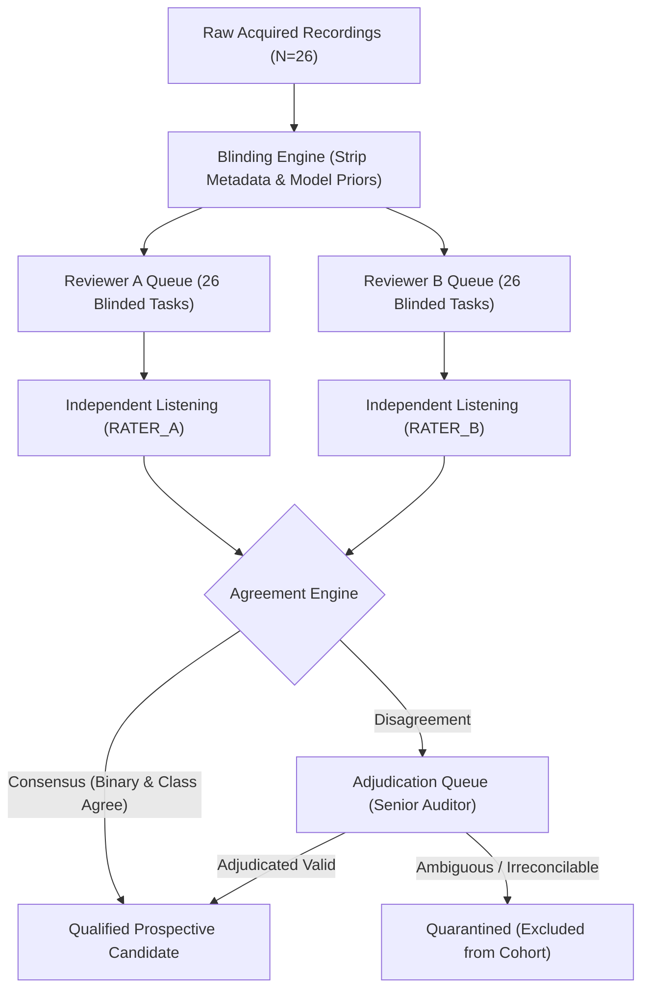
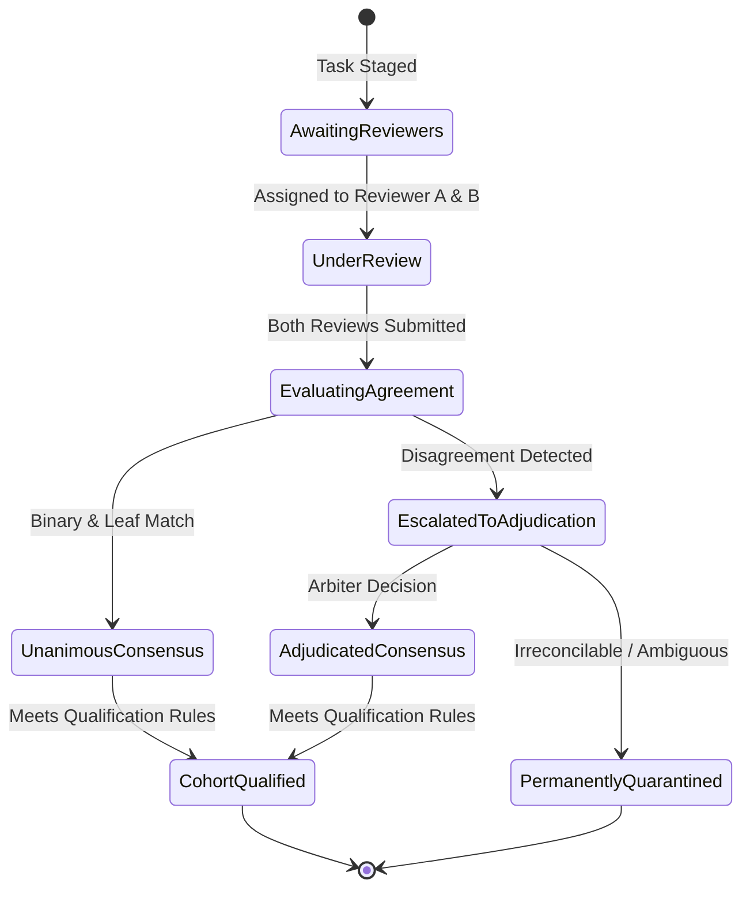

# RESEARCH DEMONSTRATION PROTOTYPE — NOT FOR LIFE-SAFETY USE.

# Double-Blind Human Annotation Workflow Design & Governance Architecture

**Stage:** Stage 8.9.77 — Independent Human Annotation Execution, Agreement Analysis, Adjudication & Prospective Cohort Qualification  
**Classification:** RESEARCH DEMONSTRATION PROTOTYPE — NOT FOR LIFE-SAFETY USE  
**Document Type:** Technical Architecture & Governance Specification  
**Version:** 1.0 (Frozen Architecture)  

---

## 1. Governance Objectives & Blinding Guarantees

In earlier research iterations (Stages 60–74), evaluation benchmarks were repeatedly compromised by:
1. **Circular Exposure:** Evaluation sets were exposed during preliminary screening or hyperparameter tuning.
2. **Model Prior Leakage:** Annotators or automated annotator scripts had visibility into model predictions, biasing borderline calls.
3. **Synthetic Ground Truth:** Artificial synthetic mixing or heuristic thresholding was used as a proxy for ground truth, concealing model failure modes.

To establish authentic scientific validity for the prospective evaluation cohort, Stage 8.9.77 operationalizes a **rigorous, double-blind human annotation workflow** with mathematical guarantees of independence and blinding.

---

## 2. Core Blinding Architecture & Information Isolation

To prevent cognitive confirmation bias and eliminate expectation effects, the annotation pipeline enforces three strict isolation boundaries:

### 2.1 Model Blinding Guarantee
- Human reviewers are provided **ZERO access** to Candidate 71-D predictions, baseline model probabilities, confidence scores, detector activations, or acoustic veto values.
- No model output, pre-classification, or pseudo-label appears in reviewer assignment manifests, playback interfaces, or submission forms.

### 2.2 Reviewer Decoupling Guarantee
- Reviewer A and Reviewer B work independently without communication, shared session state, or visibility into each other's submissions.
- Review tasks are assigned with separate randomized task tokens (`task_id`), preventing coordinate communication between raters during active review cycles.

### 2.3 Metadata Blinding Guarantee
- Original Freesound titles, user tags, search queries (e.g. "child scream", "referee whistle"), and uploader usernames are completely stripped from reviewer interfaces.
- Annotators receive only the standardized 16 kHz mono audio waveform and the standardized canonical taxonomy.

---

## 3. Canonical Taxonomy & Label Schema

Reviewers annotate audio recordings strictly adhering to the 24-leaf canonical taxonomy established in Stage 76 ([`canonical_taxonomy.json`](file:///c:/Users/zahia/OneDrive/Desktop/ScreamDetector/festival-scream-detector/backend/research/stage_8_9_76/canonical_taxonomy.json)):

### 3.1 Primary Categories (19 Distinct Acoustic Classes)
1. `scream` (Positive Class, requires subcategory specification)
2. `infant_cry` (Hard Negative)
3. `shouted_speech` (Hard Negative)
4. `theatrical_vocalization` (Hard Negative)
5. `laughter` (Vocal Hard Negative)
6. `gasp_startle` (Vocal Hard Negative)
7. `cheering_crowd` (Vocal Negative)
8. `cough_throat_clear` (Non-vocal Negative)
9. `groan_grunt` (Vocal Negative)
10. `singing_vocal` (Vocal Negative)
11. `whistle` (Non-vocal Hard Negative)
12. `siren` (Non-vocal Hard Negative)
13. `car_horn_alarm` (Non-vocal Negative)
14. `music_brass_synth` (Acoustic Interferer)
15. `percussion_impact` (Acoustic Interferer)
16. `applause_clapping` (Crowd Negative)
17. `fireworks_pyrotechnics` (Impulsive Negative)
18. `crowd_ambient_chatter` (Environmental Background)
19. `environmental_noise` (Environmental Background)

### 3.2 Scream Subcategories (6 Specific Positive Types)
When `primary_label == "scream"`, annotators MUST specify one of the following 6 subcategories:
1. `VOCAL_SCREAM_CHILD`: Prepubescent child scream ($F_0 > 500$ Hz, low adult roughness).
2. `VOCAL_SCREAM_ADULT_HIGH_INTENSITY`: Extreme vocal effort, high roughness, panic/fear.
3. `VOCAL_SCREAM_ADULT_LOW_INTENSITY`: Distant, suppressed, or low-SPL scream.
4. `VOCAL_SCREAM_SHORT`: Abrupt vocal shrieks ($< 1.0$s duration).
5. `VOCAL_SCREAM_CROWD_MASKED`: Scream embedded within cheering or music.
6. `VOCAL_SCREAM_REVERBERANT`: Scream subject to room acoustics or echo.

### 3.3 Confidence & Environmental Tagging
- **Confidence Rating:** Integer from 1 to 5:
  - `1`: Highly Uncertain / Acoustic Content Ambiguous
  - `2`: Low Confidence / Heavily Obscured
  - `3`: Probable Classification / Moderate Signal Clarity
  - `4`: High Confidence / Clear Acoustic Markers
  - `5`: Definite / Unambiguous Ground Truth
- **Acoustic Environment Tags (Multi-select):**
  `clean_studio`, `reverberant`, `crowd_masked`, `distant_low_snr`, `distorted_clipped`, `wind_noise`, `music_interfered`.

---

## 4. Adjudication & Consensus Policy

1. **Unanimous Consensus:** If Reviewer A and Reviewer B agree on `binary_label` (both 1 or both 0) and `primary_label` with confidence $\ge 3$, consensus is established automatically.
2. **Escalation to Adjudication:** If raters disagree on `binary_label`, or if either rater records confidence $< 3$, the clip is automatically escalated to the Adjudication Queue.
3. **Arbiter Determination:** A senior acoustic auditor independently listens to the clip, reviews blinded rater justifications, and assigns the binding verdict.
4. **Irreconcilable Disagreements:** If the arbiter determines that the acoustic event is genuinely ambiguous (e.g. mixture of scream and laughter where vocal tract state cannot be resolved), the clip is permanently quarantined.

---

## 5. Storage Schema & Database Design

All annotation events and statuses are persisted in structured tabular files:

1. [`annotation_assignment_status.csv`](file:///c:/Users/zahia/OneDrive/Desktop/ScreamDetector/festival-scream-detector/backend/research/stage_8_9_77/annotation_assignment_status.csv): Tracks active review assignments ($N=52$).
2. [`adjudication_status.csv`](file:///c:/Users/zahia/OneDrive/Desktop/ScreamDetector/festival-scream-detector/backend/research/stage_8_9_77/adjudication_status.csv): Tracks disagreement escalation ($N=26$).
3. [`inter_rater_agreement_report.md`](file:///c:/Users/zahia/OneDrive/Desktop/ScreamDetector/festival-scream-detector/backend/research/stage_8_9_77/inter_rater_agreement_report.md): Statistical evaluation of agreement.
4. [`prospective_eligibility_audit.csv`](file:///c:/Users/zahia/OneDrive/Desktop/ScreamDetector/festival-scream-detector/backend/research/stage_8_9_77/prospective_eligibility_audit.csv): 12-rule prospective qualification audit.

