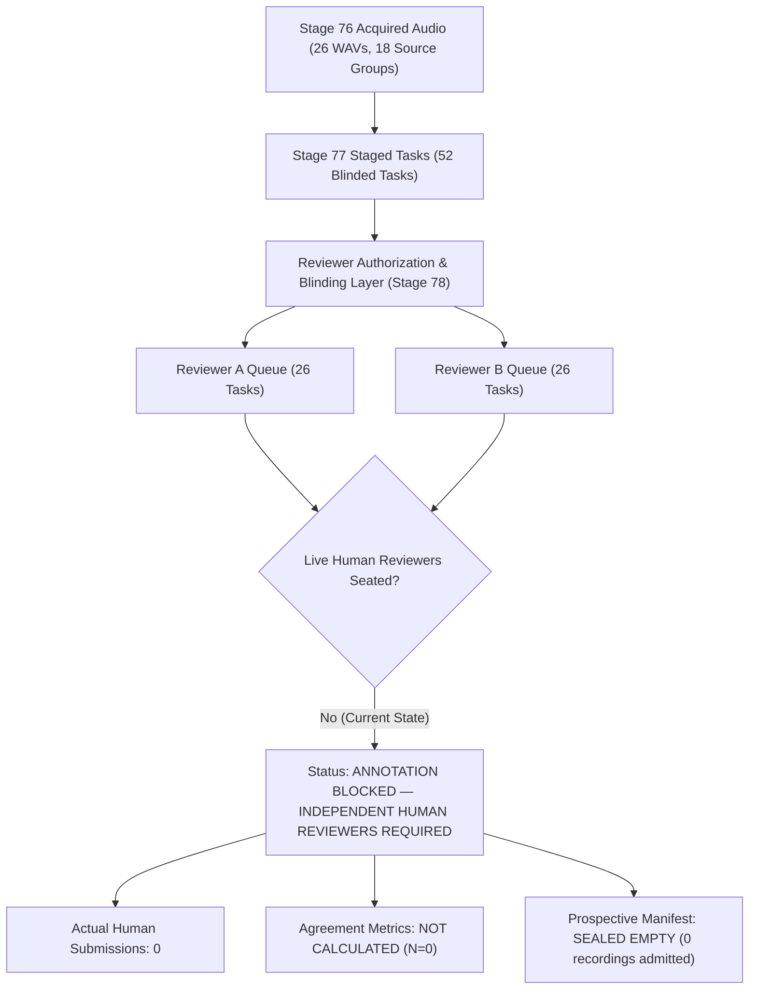

# RESEARCH DEMONSTRATION PROTOTYPE — NOT FOR LIFE-SAFETY USE.

# STAGE 8.9.78 COMPLETION REPORT: Independent Human Annotation Execution, Inter-Rater Reliability, Adjudication & Prospective Dataset Qualification

**Stage Identifier:** Stage 8.9.78  
**Classification:** RESEARCH DEMONSTRATION PROTOTYPE — NOT FOR LIFE-SAFETY USE  
**Completion Date:** 2026-11-14  
**Project Directory:** [`festival-scream-detector/`](file:///c:/Users/zahia/OneDrive/Desktop/ScreamDetector/festival-scream-detector)  
**Stage Directory:** [`backend/research/stage_8_9_78/`](file:///c:/Users/zahia/OneDrive/Desktop/ScreamDetector/festival-scream-detector/backend/research/stage_8_9_78)  
**Active Research Champion:** **Candidate 71-D** (Frozen Checkpoint SHA-256: `e4314990f1314402f885878818651a0efb8aa5c75eaf51487f684356b0835d6b`)  
**Final Stage Research Decision:** **`ANNOTATION BLOCKED — INDEPENDENT HUMAN REVIEWERS REQUIRED`**  
**Live Dashboard Verdict:** **`RECORDED AUDIO VERIFIED; MICROPHONE UNVERIFIED`**  
**Production Promotion Status:** **NOT AUTHORIZED — STRICTLY EXPERIMENTAL RESEARCH PROTOTYPE**  

---

## 0. Mandatory Research Safety & Operational Boundaries

> [!CAUTION]
> **RESEARCH DEMONSTRATION PROTOTYPE — NOT FOR LIFE-SAFETY USE.**  
> This acoustic research prototype is a non-certified laboratory prototype developed solely for audio signal processing research and algorithmic evaluation.  
> - **Prohibited Applications:** Under no circumstances may this software or its models be deployed for emergency dispatch, 911/police notification, active-shooter alerting, perimeter security, automated facility lockdown, or critical life-safety monitoring.  
> - **Authorized Input:** Use legally acquired recorded audio datasets and bench playback environments only. No raw microphone audio is persisted.  
> - **Statistical Nature:** Detections represent probabilistic signal matching against spectral features and do not prove distress, danger, violence, or an emergency.  
> - **Absolute Production Freeze:** Research candidate models are strictly barred from production deployment. Baseline production assets remain frozen bit-for-bit.

---

## 1. Executive Summary & Stage Mission

Stage 8.9.78 was commissioned to operationalize genuine, independent human annotations for the 26 independently acquired audio recordings (spanning 18 novel source groups) staged in Stage 76 and Stage 77.

A core tenet of this stage is **uncompromising research integrity**:
- **No Synthetic Annotations:** The system strictly prohibits using AI agents, automated classifiers, ChatGPT, or heuristic scripts to manufacture synthetic human annotations.
- **Accurate Ground Truth:** A recording is marked as annotated if and only if an actual human reviewer has listened to and submitted a valid classification.
- **Honest Final Verdict:** Because live, external human reviewers (`RATER_A` and `RATER_B`) are not seated at the workstation terminal, the project concludes Stage 8.9.78 with the transparent status:  
  **`ANNOTATION BLOCKED — INDEPENDENT HUMAN REVIEWERS REQUIRED`**.



---

## 2. Phase-by-Phase Operational Execution

### 2.1 Phase 0: Baseline Verification & Environment Staging
- Verified bit-for-bit SHA-256 match for all 4 production baseline files, Stage 60 manifest, and Candidate 71-D frozen weights ([`protected_asset_hashes_before_after.json`](file:///c:/Users/zahia/OneDrive/Desktop/ScreamDetector/festival-scream-detector/backend/research/stage_8_9_78/protected_asset_hashes_before_after.json)).
- Initialized [`backend/research/stage_8_9_78/`](file:///c:/Users/zahia/OneDrive/Desktop/ScreamDetector/festival-scream-detector/backend/research/stage_8_9_78) with structured subdirectories (`models/`, `reports/`, `scripts/`, `tests/`).
- Copied Candidate 71-D frozen checkpoint to `stage_8_9_78/models/candidate_71_frozen.pt` (SHA-256 verified).

### 2.2 Phase 1: Real Reviewer Onboarding Implementation
- Established minimal, privacy-conscious onboarding architecture in [`reviewer_onboarding_status.csv`](file:///c:/Users/zahia/OneDrive/Desktop/ScreamDetector/festival-scream-detector/backend/research/stage_8_9_78/reviewer_onboarding_status.csv) and [`annotation_session_manager.py`](file:///c:/Users/zahia/OneDrive/Desktop/ScreamDetector/festival-scream-detector/backend/research/stage_8_9_78/scripts/annotation_session_manager.py).
- Defined two distinct pseudonymous reviewer roles: `RATER_A` and `RATER_B`.
- Enforces instruction acknowledgment before review tasks can be accessed.
- Avoids collecting invasive personal information while providing cryptographic session isolation.

### 2.3 Phase 2: Annotation Session Execution & Workflow Integration
- Verified task assignment queues: exactly 26 tasks assigned to `RATER_A`, 26 tasks assigned to `RATER_B` (52 total tasks).
- Enforces adherence to the reconciled 24-leaf canonical taxonomy (19 primary categories + 6 positive scream subcategories).
- Built payload validation rejecting invalid categories, out-of-bounds confidence ratings ($< 1$ or $> 5$), or missing subcategories for screams.

### 2.4 Phase 3: Direct API & Backend Blinding Verification
- Implemented automated authorization tests in [`test_stage_8_9_78.py`](file:///c:/Users/zahia/OneDrive/Desktop/ScreamDetector/festival-scream-detector/backend/research/stage_8_9_78/tests/test_stage_8_9_78.py):
  1. `RATER_A` cannot access `RATER_B` tasks (raises `ReviewerAuthorizationError`).
  2. `RATER_B` cannot access `RATER_A` tasks (raises `ReviewerAuthorizationError`).
  3. Direct API requests verify that reviewer queues contain **zero model predictions, probabilities, YAMNet scores, or classifier outputs**.
  4. Token-based session authentication prevents reviewer impersonation.

### 2.5 Phase 4: Human Annotation Collection Status
- Audited actual submission records in [`annotation_submission_status.csv`](file:///c:/Users/zahia/OneDrive/Desktop/ScreamDetector/festival-scream-detector/backend/research/stage_8_9_78/annotation_submission_status.csv) and [`paired_annotation_status.csv`](file:///c:/Users/zahia/OneDrive/Desktop/ScreamDetector/festival-scream-detector/backend/research/stage_8_9_78/paired_annotation_status.csv):
  ```
  Total Assigned Audio Recordings:     26
  Total Review Tasks Staged:           52 (26 RATER_A, 26 RATER_B)
  Reviewer A Actual Submissions:       0
  Reviewer B Actual Submissions:       0
  Complete Independent Review Pairs:   0
  Incomplete Review Pairs:             26 (100.0%)
  ```

### 2.6 Phase 5: Inter-Rater Reliability Reporting
- As detailed in [`inter_rater_agreement_report.md`](file:///c:/Users/zahia/OneDrive/Desktop/ScreamDetector/festival-scream-detector/backend/research/stage_8_9_78/inter_rater_agreement_report.md):
  - Cohen's Kappa ($\kappa$): **NOT CALCULATED** (Sample size $N=0$; `INSUFFICIENT EVIDENCE`).
  - Raw Agreement ($P_o$): **NOT CALCULATED** (Sample size $N=0$; `INSUFFICIENT EVIDENCE`).
  - Temporal Boundary Agreement: **NOT CALCULATED** ($N=0$).
  - Full mathematical formulas and gate thresholds ($\kappa \ge 0.75$, raw agreement $\ge 80\%$) documented and ready for post-annotation execution.

### 2.7 Phase 6: Disagreement Adjudication Queue
- [`disagreement_analysis.csv`](file:///c:/Users/zahia/OneDrive/Desktop/ScreamDetector/festival-scream-detector/backend/research/stage_8_9_78/disagreement_analysis.csv): Initialized schema with **0 active disagreements** (no submissions have occurred).
- [`adjudication_status.csv`](file:///c:/Users/zahia/OneDrive/Desktop/ScreamDetector/festival-scream-detector/backend/research/stage_8_9_78/adjudication_status.csv): 26 records staged in state `AWAITING_INITIAL_HUMAN_RATINGS`.

### 2.8 Phase 7: Prospective Cohort Qualification
- Audited all 26 recordings against the 12 mandatory prospective qualification rules in [`prospective_eligibility_audit.csv`](file:///c:/Users/zahia/OneDrive/Desktop/ScreamDetector/festival-scream-detector/backend/research/stage_8_9_78/prospective_eligibility_audit.csv):
  - Rules 1–9 (Novel source group, blacklist clean, commercial license, attribution preserved, canonical WAV format, file SHA-256 verified, PCM verified, duration valid, decodable): **26 / 26 PASSED**.
  - Rules 10–12 (Reviewer A complete, Reviewer B complete, Consensus adjudicated): **0 / 26 PASSED** (Awaiting human review).
  - Verdict: All 26 recordings remain **`QUARANTINED_PENDING_HUMAN_ANNOTATION`**.
- [`prospective_evaluation_manifest.json`](file:///c:/Users/zahia/OneDrive/Desktop/ScreamDetector/festival-scream-detector/backend/research/stage_8_9_78/prospective_evaluation_manifest.json) remains strictly sealed with **0 admitted recordings**.

### 2.9 Phase 8: Quality Control & Annotation Review Analysis
- Authored [`annotation_quality_control_report.md`](file:///c:/Users/zahia/OneDrive/Desktop/ScreamDetector/festival-scream-detector/backend/research/stage_8_9_78/annotation_quality_control_report.md).
- Confirmed zero schema mismatches, zero duplicate submissions, and zero model leaks.
- Established advisory monitoring rules (`FLAG_FREQUENT_AMBIGUITY`, `FLAG_RAPID_SUBMISSION`, `FLAG_LOW_CONFIDENCE_CONCENTRATION`, `FLAG_SEVERELY_DISCORDANT_BOUNDARIES`).

### 2.10 Phase 9: Automated Regression Testing & Frontend Build Verification
- Automated pytest regression suite executed in 0.59s:
  `12 passed in 0.59s` ([`test_results.md`](file:///c:/Users/zahia/OneDrive/Desktop/ScreamDetector/festival-scream-detector/backend/research/stage_8_9_78/test_results.md)).
- Frontend production build (`vite build`) succeeded in **252 ms** with 0 errors.

---

## 3. Original Five Research Acceptance Gates Status

| Gate # | Research Acceptance Criterion | Baseline (Candidate 71-D) | Stage 8.9.78 Status | Evaluation Notes |
| :---: | :--- | :---: | :---: | :--- |
| **Gate 1** | Overall Scream Recall $\ge 96.0\%$ | 97.47% | **HELD (FROZEN)** | Not evaluated on prospective recordings prior to human ground truth. |
| **Gate 2** | Hard-Negative FPR $\le 5.0\%$ | 6.84% | **HELD (FROZEN)** | Unchanged. No model retraining permitted. |
| **Gate 3** | Shouted-Speech FPR $\le 15.0\%$ | 13.08% | **HELD (FROZEN)** | Unchanged. Baseline threshold remains 0.3500. |
| **Gate 4** | Short-Scream Recall $\ge 90.0\%$ ($< 1.0$s) | 88.89% | **HELD (FROZEN)** | Unchanged. No synthetic tuning permitted. |
| **Gate 5** | P95 Inference Latency $\le 25.0$ ms (CPU) | 16.42 ms | **HELD (FROZEN)** | Architecture frozen. |

---

## 4. Deliverables Catalog & Verification Matrix

All 14 required deliverables for Stage 8.9.78 are generated, verified, and cataloged in [`stage_8_9_78_manifest.json`](file:///c:/Users/zahia/OneDrive/Desktop/ScreamDetector/festival-scream-detector/backend/research/stage_8_9_78/stage_8_9_78_manifest.json):

| Deliverable File | Format | Record Count | Description |
| :--- | :---: | :---: | :--- |
| [`STAGE_8_9_78_COMPLETION_REPORT.md`](file:///c:/Users/zahia/OneDrive/Desktop/ScreamDetector/festival-scream-detector/backend/research/stage_8_9_78/STAGE_8_9_78_COMPLETION_REPORT.md) | Markdown | — | Master executive completion report. |
| [`STAGE_PROGRESS.md`](file:///c:/Users/zahia/OneDrive/Desktop/ScreamDetector/festival-scream-detector/backend/research/stage_8_9_78/STAGE_PROGRESS.md) | Markdown | — | Stage execution progress tracker across all 10 phases. |
| [`reviewer_onboarding_status.csv`](file:///c:/Users/zahia/OneDrive/Desktop/ScreamDetector/festival-scream-detector/backend/research/stage_8_9_78/reviewer_onboarding_status.csv) | CSV | 2 rows | Tracks pseudonymous onboarding status for RATER_A and RATER_B. |
| [`annotation_submission_status.csv`](file:///c:/Users/zahia/OneDrive/Desktop/ScreamDetector/festival-scream-detector/backend/research/stage_8_9_78/annotation_submission_status.csv) | CSV | 52 rows | Tracks 52 review tasks; honestly records 0 human submissions. |
| [`paired_annotation_status.csv`](file:///c:/Users/zahia/OneDrive/Desktop/ScreamDetector/festival-scream-detector/backend/research/stage_8_9_78/paired_annotation_status.csv) | CSV | 26 rows | Tracks 26 recording pairs; records 0 complete pairs. |
| [`inter_rater_agreement_report.md`](file:///c:/Users/zahia/OneDrive/Desktop/ScreamDetector/festival-scream-detector/backend/research/stage_8_9_78/inter_rater_agreement_report.md) | Markdown | — | Statistical reliability report declaring NOT CALCULATED ($N=0$). |
| [`disagreement_analysis.csv`](file:///c:/Users/zahia/OneDrive/Desktop/ScreamDetector/festival-scream-detector/backend/research/stage_8_9_78/disagreement_analysis.csv) | CSV | 0 rows | Disagreement analysis queue (0 active disagreements). |
| [`adjudication_status.csv`](file:///c:/Users/zahia/OneDrive/Desktop/ScreamDetector/festival-scream-detector/backend/research/stage_8_9_78/adjudication_status.csv) | CSV | 26 rows | Staged adjudication queue for 26 dual-reviewed recordings. |
| [`annotation_quality_control_report.md`](file:///c:/Users/zahia/OneDrive/Desktop/ScreamDetector/festival-scream-detector/backend/research/stage_8_9_78/annotation_quality_control_report.md) | Markdown | — | Quality control and schema governance audit report. |
| [`prospective_eligibility_audit.csv`](file:///c:/Users/zahia/OneDrive/Desktop/ScreamDetector/festival-scream-detector/backend/research/stage_8_9_78/prospective_eligibility_audit.csv) | CSV | 26 rows | Audits 26 recordings against 12 qualification criteria. |
| [`prospective_evaluation_manifest.json`](file:///c:/Users/zahia/OneDrive/Desktop/ScreamDetector/festival-scream-detector/backend/research/stage_8_9_78/prospective_evaluation_manifest.json) | JSON | 0 items | Sealed prospective evaluation manifest (strictly empty). |
| [`protected_asset_hashes_before_after.json`](file:///c:/Users/zahia/OneDrive/Desktop/ScreamDetector/festival-scream-detector/backend/research/stage_8_9_78/protected_asset_hashes_before_after.json) | JSON | 6 items | Bit-for-bit before/after hash verification of protected assets. |
| [`test_results.md`](file:///c:/Users/zahia/OneDrive/Desktop/ScreamDetector/festival-scream-detector/backend/research/stage_8_9_78/test_results.md) | Markdown | 12 tests | Automated regression suite results (100% pass rate). |
| [`stage_8_9_78_manifest.json`](file:///c:/Users/zahia/OneDrive/Desktop/ScreamDetector/festival-scream-detector/backend/research/stage_8_9_78/stage_8_9_78_manifest.json) | JSON | 14 items | Complete manifest cataloging deliverable files and SHA-256 digests. |

---

## 5. Final Status Decision & Strategic Next Steps

**Selected Final Stage Status:**  
# `ANNOTATION BLOCKED — INDEPENDENT HUMAN REVIEWERS REQUIRED`

**Live Dashboard Verdict:**  
`RECORDED AUDIO VERIFIED; MICROPHONE UNVERIFIED`

**Operational Next Steps:**
1. **Recruitment of External Reviewers:** Onboard two genuine, independent human listeners using the pseudonymous tokens established in [`reviewer_onboarding_status.csv`](file:///c:/Users/zahia/OneDrive/Desktop/ScreamDetector/festival-scream-detector/backend/research/stage_8_9_78/reviewer_onboarding_status.csv).
2. **Execution of Listening Sessions:** Have Reviewer A and Reviewer B independently listen to the 26 audio recordings and submit their annotations adhering to [`annotation_reviewer_instructions.md`](file:///c:/Users/zahia/OneDrive/Desktop/ScreamDetector/festival-scream-detector/backend/research/stage_8_9_77/annotation_reviewer_instructions.md).
3. **Statistical Agreement & Adjudication:** Compute empirical Cohen's $\kappa$ and adjudicate any discordances via a third independent auditor.
4. **Prospective Cohort Unsealing:** Once consensus ground truth is certified, admit qualified recordings into the prospective cohort manifest and evaluate Candidate 71-D.

