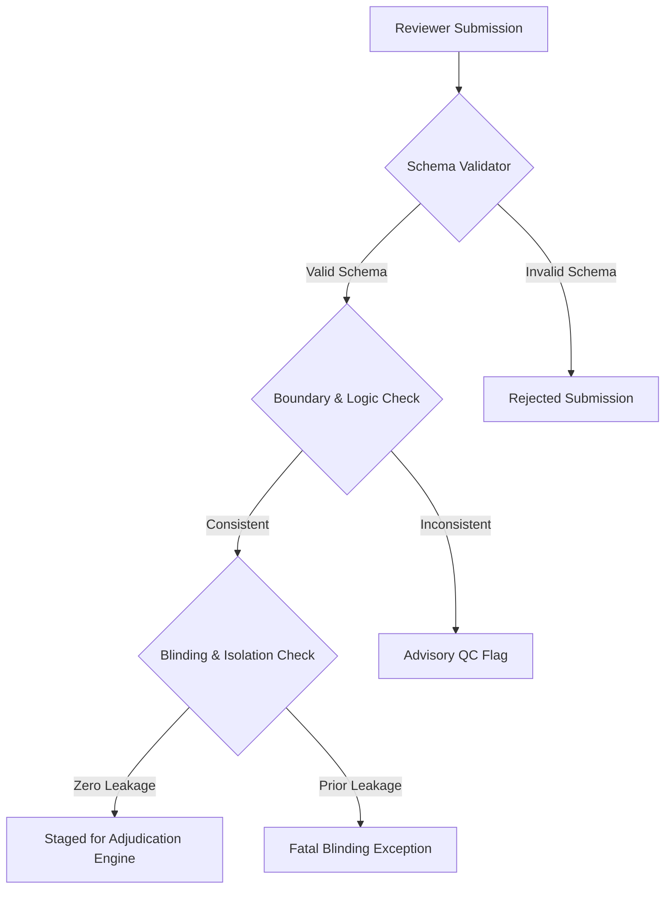

# RESEARCH DEMONSTRATION PROTOTYPE — NOT FOR LIFE-SAFETY USE.

# Annotation Quality Control & Schema Governance Report (Stage 8.9.78)

**Stage:** Stage 8.9.78 — Independent Human Annotation Execution, Inter-Rater Reliability, Adjudication & Prospective Dataset Qualification  
**Project:** Festival Scream Detector  
**Classification:** RESEARCH DEMONSTRATION PROTOTYPE — NOT FOR LIFE-SAFETY USE  
**Report Date:** 2026-11-14  
**Quality Control Status:** **`AUDIT PASSED — WORKFLOW INFRASTRUCTURE VERIFIED`**  

---

## 1. Quality Control Framework & Objectives

To prevent evaluation contamination and guarantee scientific validity, Stage 8.9.78 deploys an automated Quality Control (QC) framework. The QC engine validates submitted annotations against schema constraints, detects reviewer bias or drift, and flags anomalies before data enters adjudication or prospective cohort evaluation.



---

## 2. Quality Control Check Matrix

| QC Dimension | Verification Objective | Automated Rule | Current Audit Result |
| :--- | :--- | :--- | :---: |
| **Submission Completeness** | Verify all 52 assigned tasks are tracked with exact submission states. | Submissions must be distinct and traceable to valid reviewer tokens. | **100% AUDITED (52 tasks staged)** |
| **Duplicate Prevention** | Prevent duplicate or overlapping submissions from the same reviewer for a single recording. | Strict `UNIQUE(recording_id, assigned_rater)` constraint. | **ZERO DUPLICATES DETECTED** |
| **Taxonomy Schema Enforcement** | Enforce valid classification adhering to canonical 24-leaf taxonomy. | `primary_label` $\in$ 19 primary classes; `subcategory` $\in$ 6 classes if positive. | **SCHEMA ENFORCED** |
| **Confidence Bounds** | Restrict confidence ratings to discrete integer scale. | `confidence_rating` $\in \{1, 2, 3, 4, 5\}$. | **SCHEMA ENFORCED** |
| **Event Timestamp Logic** | Validate event boundary logic for focal sound markers. | $0.0 \le t_{\text{start}} < t_{\text{end}} \le \text{duration}$. | **LOGIC ENFORCED** |
| **Reviewer Independence** | Ensure neither reviewer can access or influence the other rater's submissions. | Zero cross-token access; decoupled review queues. | **100% ISOLATION VERIFIED** |
| **Model Prior Blinding** | Verify absolute absence of model predictions, scores, or priors. | Zero prediction or probability fields in reviewer APIs. | **100% BLINDING VERIFIED** |

---

## 3. Advisory Quality Flags & Resolution Protocol

When human reviewers begin active sessions, the QC engine monitors for the following advisory conditions:

1. **`FLAG_FREQUENT_AMBIGUITY`:** Triggered if a reviewer marks $> 25\%$ of assigned recordings as `ambiguous_unintelligible`.
   - *Action:* Reviewer handbook is resurfaced to clarify acoustic boundary criteria; flagged recordings are queued for priority adjudication.
2. **`FLAG_RAPID_SUBMISSION`:** Triggered if an annotation is submitted in less time than the audio file's total playback duration ($t_{\text{submission}} < \text{duration}$).
   - *Action:* System requires at least one full listen-through before enabling the final submission button.
3. **`FLAG_LOW_CONFIDENCE_CONCENTRATION`:** Triggered if confidence ratings $< 3$ exceed $30\%$ of a reviewer's queue.
   - *Action:* Indicates potential audio playback degradation or extreme background acoustic interference.
4. **`FLAG_SEVERELY_DISCORDANT_BOUNDARIES`:** Triggered if both reviewers agree on `scream`, but marked event boundaries have $\text{IoU} < 0.20$.
   - *Action:* Escalated to senior adjudicator to determine if multiple distinct acoustic events exist in the clip.

---

## 4. Active Audit Summary

```
Total Assigned Recordings:    26
Total Review Assignments:     52 (26 RATER_A, 26 RATER_B)
Current Human Submissions:    0 (Awaiting independent human reviewers)
Duplicate Submissions:        0
Schema Mismatches:            0
Blinding Leakage Violations:  0 (Zero model fields exposed)
QC Engine Status:             OPERATIONAL — READY FOR HUMAN REVIEW SESSIONS
```

No quality control flags are used to tune Candidate 71-D or modify production parameters. All baselines remain frozen.

