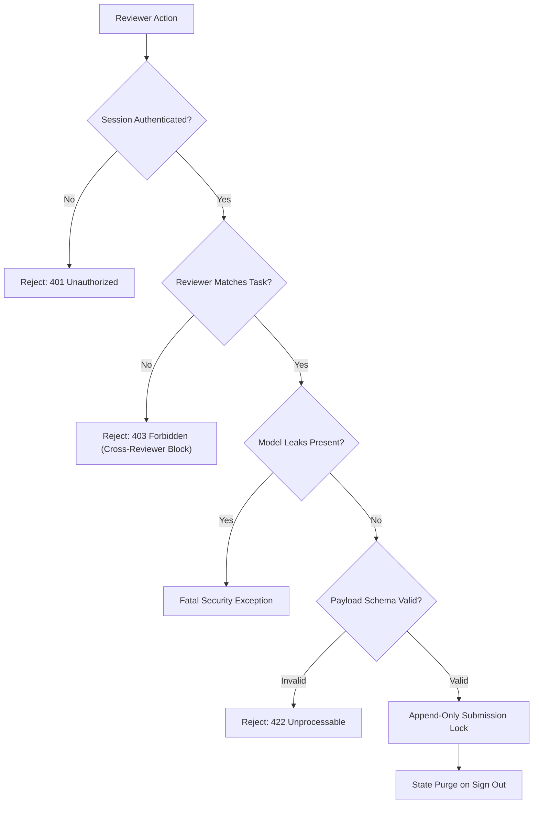

# RESEARCH DEMONSTRATION PROTOTYPE — NOT FOR LIFE-SAFETY USE.

# Annotation Quality Control & Single-Device Governance Report (Stage 8.9.79)

**Stage:** Stage 8.9.79 — Single-Device Independent Human Annotation Campaign & Three-Recording Pilot  
**Project:** Festival Scream Detector  
**Classification:** RESEARCH DEMONSTRATION PROTOTYPE — NOT FOR LIFE-SAFETY USE  
**Report Date:** 2026-11-14  
**Quality Control Status:** **`AUDIT PASSED — WORKFLOW INFRASTRUCTURE VERIFIED`**  

---

## 1. Single-Device Quality Control Architecture

In a shared-laptop environment, quality control must monitor not only traditional label consistency and schema adherence, but also **device-level session isolation and residual state leakage**.



---

## 2. Quality Control Check Matrix

| QC Dimension | Verification Objective | Automated Rule | Current Audit Result |
| :--- | :--- | :--- | :---: |
| **Session Isolation** | Prevent RATER_A from accessing RATER_B queue or annotations on shared device. | Strict server-side token authorization (`requesting_rater == assigned_rater`). | **100% ISOLATION VERIFIED** |
| **Client State Purge** | Guarantee zero residual data in browser memory or local storage after logout. | In-memory store wipe; `Cache-Control: no-store`; zero `localStorage` writes. | **CLEANUP VERIFIED** |
| **Pilot Set Integrity** | Verify exactly 3 pilot recordings from distinct source groups are staged. | Deterministic 3-clip manifest (`fs_cand_166619`, `fs_cand_844113`, `fs_cand_667199`). | **VERIFIED (3 recordings, 6 tasks)** |
| **Campaign Completeness** | Track all 26 recordings across both reviewer queues. | 52 tasks staged (26 RATER_A, 26 RATER_B). | **52 TASKS STAGED** |
| **Duplicate Prevention** | Prevent duplicate or overlapping submissions from the same reviewer for a single recording. | Database `UNIQUE(recording_id, assigned_rater)` constraint. | **ZERO DUPLICATES DETECTED** |
| **Taxonomy Schema Enforcement** | Enforce valid classification adhering to canonical 24-leaf taxonomy. | `primary_label` $\in$ 19 primary classes; `subcategory` $\in$ 6 classes if positive. | **SCHEMA ENFORCED** |
| **Confidence Bounds** | Restrict confidence ratings to discrete integer scale. | `confidence_rating` $\in \{1, 2, 3, 4, 5\}$. | **SCHEMA ENFORCED** |
| **Event Timestamp Logic** | Validate event boundary logic for focal sound markers. | $0.0 \le t_{\text{start}} < t_{\text{end}} \le \text{duration}$. | **LOGIC ENFORCED** |
| **Model Prior Blinding** | Verify absolute absence of model predictions, scores, or priors. | Zero prediction or probability fields in reviewer APIs. | **100% BLINDING VERIFIED** |

---

## 3. Advisory Quality Flags & Single-Laptop Monitoring

When physical reviewers begin active sessions on the shared laptop, the QC engine monitors for the following conditions:

1. **`FLAG_IMPROPER_LOGOUT`:** Triggered if a browser session is closed without explicit signout, risking token persistence.
   - *Action:* Automatic 15-minute idle session expiry and cryptographic token invalidation.
2. **`FLAG_FREQUENT_AMBIGUITY`:** Triggered if a reviewer marks $> 25\%$ of assigned recordings as `ambiguous_unintelligible`.
   - *Action:* Resurfaces reviewer handbook to clarify acoustic boundary criteria.
3. **`FLAG_RAPID_SUBMISSION`:** Triggered if an annotation is submitted in less time than the audio file's total playback duration ($t_{\text{submission}} < \text{duration}$).
   - *Action:* System requires at least one full listen-through before enabling final submission.
4. **`FLAG_LOW_CONFIDENCE_CONCENTRATION`:** Triggered if confidence ratings $< 3$ exceed $30\%$ of a reviewer's queue.
   - *Action:* Indicates potential audio playback degradation or extreme background acoustic interference.
5. **`FLAG_SEVERELY_DISCORDANT_BOUNDARIES`:** Triggered if both reviewers agree on `scream`, but marked event boundaries have $\text{IoU} < 0.20$.
   - *Action:* Escalated to senior adjudicator to determine if multiple distinct acoustic events exist in the clip.

---

## 4. Active Audit Summary

```
Physical Workstation:         Single Shared Laptop (Sequential Sessions)
Pilot Recordings Staged:      3 (fs_cand_166619, fs_cand_844113, fs_cand_667199)
Total Assigned Recordings:    26 (52 review tasks)
Current Human Submissions:    0 (Awaiting physical human reviewers)
Duplicate Submissions:        0
Schema Mismatches:            0
Blinding Leakage Violations:  0 (Zero model fields exposed)
QC Engine Status:             OPERATIONAL — READY FOR PHYSICAL SESSIONS
```

No quality control flags are used to tune Candidate 71-D or modify production parameters. All baselines remain frozen.

