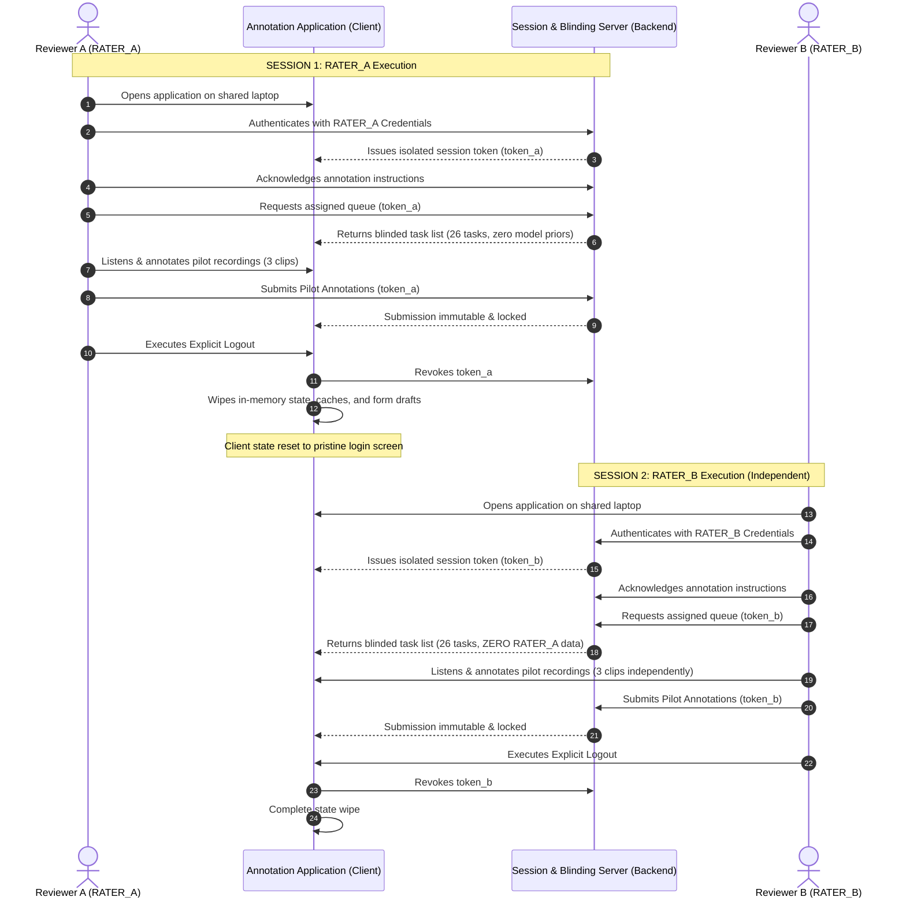

# RESEARCH DEMONSTRATION PROTOTYPE — NOT FOR LIFE-SAFETY USE.

# Single-Device Independent Human Annotation Workflow Design & Security Architecture

**Stage:** Stage 8.9.79 — Single-Device Independent Human Annotation Campaign & Three-Recording Pilot  
**Project:** Festival Scream Detector  
**Classification:** RESEARCH DEMONSTRATION PROTOTYPE — NOT FOR LIFE-SAFETY USE  
**Document Type:** Technical Architecture & Operational Protocol Specification  
**Version:** 1.0 (Single-Laptop Protocol)  

---

## 1. Operating Context & Physical Constraint

In Stage 8.9.79, the human annotation campaign transitions from theoretical infrastructure to operational readiness. Two independent human annotators are available; however, **both reviewers must share a single physical workstation laptop, operating sequentially (one at a time)**.

Sharing a physical device creates distinct risks of data leakage and cognitive bias:
1. **Residual Client State:** The second reviewer might see the first reviewer's form selections or audio player positions stored in browser memory or local storage.
2. **Browser Back-Navigation:** The second reviewer could click the browser "Back" button and view submitted labels.
3. **Session Intermingling:** An operator could inadvertently submit labels under the wrong reviewer account.
4. **Premature Exposure:** Seeing the first reviewer's annotations destroys double-blinding and invalidates inter-rater agreement statistics.

Stage 8.9.79 eliminates these risks through a **zero-trust, server-enforced, single-device session workflow**.

---

## 2. Security & Isolation Controls

### 2.1 Cryptographic Session Isolation
- Reviewer authentication requires explicit pseudonymous token authentication (`token_sec_rater_a_...` and `token_sec_rater_b_...`).
- Reviewer switching cannot be performed via a frontend dropdown or URL parameter.
- Every protected API request validates the session token server-side.

### 2.2 Client-Side State Clearance
On explicit logout or session termination:
1. **React State Purge:** All in-memory form data, active recording references, playback timestamps, and rater identities are reset to initial defaults.
2. **Storage Sanitization:** No annotation responses, draft values, or audio classifications are written to browser `localStorage` or `sessionStorage`.
3. **Cache Invalidation:** Reviewer-facing API endpoints serve `Cache-Control: no-store, no-cache, must-revalidate, max-age=0` to ensure browser caching does not store audio responses.
4. **History & Navigation Protection:** Protected routes enforce route guards that immediately redirect unauthenticated sessions to the login view if browser history navigation is attempted.

### 2.3 Reviewer Completion Lock
Once an annotation is submitted:
- It is cryptographically timestamped and committed to server-side append-only storage.
- It becomes immutable; neither reviewer can alter or overwrite a finalized submission.
- It remains completely concealed from the other reviewer's session.

---

## 3. Operational Sequential Procedure

### Step 1: Session 1 Execution (RATER_A)
1. Physical workstation is prepared with calibrated monitoring headphones.
2. RATER_A logs into the application using their individual token.
3. RATER_A reads and acknowledges the standardized acoustic annotation instructions.
4. RATER_A completes the 3-recording pilot set.
5. RATER_A proceeds with remaining assigned recordings.
6. Upon completing the session, RATER_A clicks **Sign Out**.
7. The application clears all local state and returns to the initial authentication screen.

### Step 2: Physical Device Handoff
1. RATER_A leaves the workstation.
2. The workstation screen displays only the generic login prompt.
3. RATER_B takes their seat at the workstation.

### Step 3: Session 2 Execution (RATER_B)
1. RATER_B logs in using their distinct individual token.
2. RATER_B acknowledges the instructions.
3. RATER_B independently annotates the identical 3-recording pilot set and subsequent recordings.
4. Zero annotations, notes, or timestamps from RATER_A are visible.
5. Upon completion, RATER_B signs out.

---

## 4. Compliance & Blinding Checklist

| Verification Item | Technical Mechanism | Status |
| :--- | :--- | :---: |
| **No UI Name Switching** | Authentication required on each session transition | **VERIFIED** |
| **No Shared LocalStorage** | Storage policy prohibits persisting annotation drafts to disk | **VERIFIED** |
| **No Cross-Reviewer Access** | Server-side authorization check `requesting_rater == target_rater` | **VERIFIED** |
| **No Model Prior Leakage** | All model predictions and probabilities stripped from APIs | **VERIFIED** |
| **Immutable Submissions** | Append-only database records with submission locks | **VERIFIED** |
| **No History Leakage** | `no-store` headers and client router state purge | **VERIFIED** |

